# Guida di Radio Regia

Come si usa la radio, passo per passo. Le cose di tutti i giorni sono all'inizio, l'installazione (che si fa una
volta sola) è più in fondo.

La guida si apre anche **dentro la regia** (scheda **Guida**) e **nel pannello** dal telefono (menu **☰** →
**📖 Guida**). I numeri gialli sulle immagini corrispondono ai numeri nel testo.

**Ultimo aggiornamento:** 27/11/2026, il player della radio si installa come app su telefono e computer.

## Indice

**Tutti i giorni**

1. [Come funziona, in un minuto](#1-come-funziona-in-un-minuto)
2. [Andare in onda dalla regia](#2-andare-in-onda-dalla-regia)
3. [Fare una diretta esterna](#3-fare-una-diretta-esterna)
4. [Il pannello dal telefono](#4-il-pannello-dal-telefono)
5. [Parlare in diretta dal pannello](#5-parlare-in-diretta-dal-pannello)
6. [Ospiti in diretta](#6-ospiti-in-diretta)
7. [Diretta autonoma, senza la regia](#7-diretta-autonoma-senza-la-regia)
8. [Eventi a orario](#8-eventi-a-orario)

**Funzioni in più**

9. [Libreria e scheda brano](#9-libreria-e-scheda-brano)
10. [Rotazioni con l'AI](#10-rotazioni-con-lai)
11. [Registro e report SIAE](#11-registro-e-report-siae)
12. [Notiziari e voce sintetica](#12-notiziari-e-voce-sintetica)
13. [Programmi, puntate e repliche](#13-programmi-puntate-e-repliche)
14. [Statistiche degli ascoltatori](#14-statistiche-degli-ascoltatori)
15. [Dirette video su YouTube e Facebook](#15-dirette-video-su-youtube-e-facebook)
16. [Allarmi, notifiche e bot Telegram](#16-allarmi-notifiche-e-bot-telegram)
17. [Backup](#17-backup)

**Una volta sola: installazione e impostazioni**

18. [Installare la regia su Windows](#18-installare-la-regia-su-windows)
19. [Il server su Proxmox](#19-il-server-su-proxmox)
20. [Impostazioni del server dal pannello](#20-impostazioni-del-server-dal-pannello)
21. [Collegare la regia al server](#21-collegare-la-regia-al-server)
22. [La musica sul server](#22-la-musica-sul-server)
23. [Utenti del pannello](#23-utenti-del-pannello)

**Aiuto**

24. [Problemi comuni](#24-problemi-comuni)
25. [In arrivo](#25-in-arrivo)
26. [Modifiche alla guida](#26-modifiche-alla-guida)

---

## 1. Come funziona, in un minuto

```
PC di regia (Windows, 4G) ──▶ Server di casa ──▶ ascoltatori
App per le esterne ────────▶   (il "ponte")  ├─▶ Icecast secondario (facoltativo)
Telefono (pannello) ───────▶                 └─▶ YouTube / Facebook (quando le avvii)
```

- La **regia** è il programma sul PC dello studio: manda in onda brani, jingle ed eventi.
- Il **server** (chiamato anche **ponte**) sta a casa. Riceve l'audio e lo manda a tutti gli ascoltatori, sempre
  con lo stesso identico segnale su tutte le uscite.
- In onda va **una sola cosa alla volta**, in quest'ordine di precedenza:
    1. la **diretta esterna** (un'app collegata da fuori);
    2. la **diretta autonoma** (la musica del server, avviata dal pannello);
    3. la **regia**;
    4. se non c'è nessuno, la **musica di riserva**: il server suona da solo brani a caso della sua libreria,
       senza ripetere di seguito lo stesso artista, ogni volta da un brano nuovo dall'inizio, con titolo e
       artista per i lettori degli ascoltatori. Parte solo dopo **8 secondi** senza programma (si cambia in
       **Impostazioni server** → **Attesa prima della musica di emergenza**): un salto breve del collegamento
       si sente come un attimo di silenzio, non fa partire la riserva. Quando la regia torna, riprende lei da sola.
- Il **pannello** è una pagina web: dal telefono comandi la regia, parli in diretta, fai entrare gli ospiti e
  cambi le impostazioni del server.

## 2. Andare in onda dalla regia

**La prima volta** che apri la regia compare il **Benvenuto**, in tre passi: scegli la cartella della musica,
controlla le schede audio (il RodeCaster lo trova da solo) e incolla il **codice di collegamento** al server (vedi
[Collegare la regia al server](#21-collegare-la-regia-al-server)). Ogni passo si può saltare con **Salta, lo faccio
dopo**.

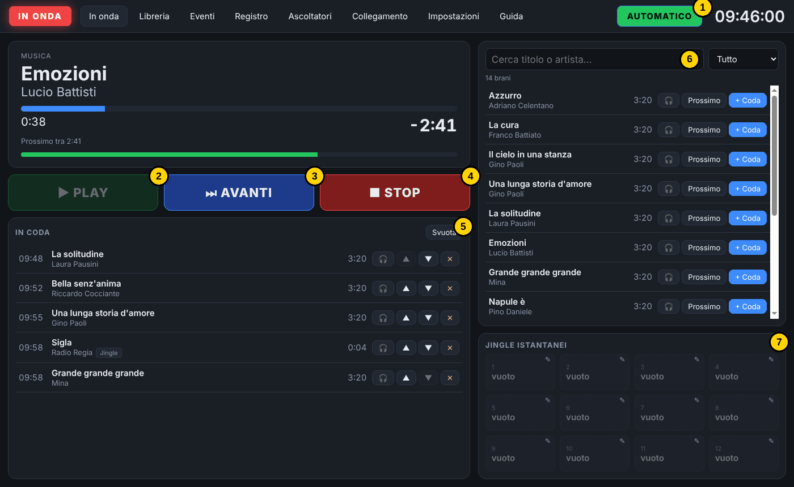

1. **AUTOMATICO / MANUALE**. In **automatico** la regia sceglie i brani da sola e non lascia mai il silenzio. In
   **manuale** va in onda solo quello che metti in coda tu, e alla fine di ogni brano la regia **si ferma**: il
   successivo parte quando premi **▶ PLAY** (o **⏭ AVANTI**). Gli eventi a orario partono comunque da soli.
2. **▶ PLAY** fa partire la coda.
3. **⏭ AVANTI** sfuma il brano in onda e passa al successivo.
4. **■ STOP** sfuma e ferma tutto (e passa in manuale).
5. **In coda**: i prossimi brani con l'orario previsto. Con le frecce li sposti, con la ✕ li togli, con 🎧 li
   ascolti in cuffia. **Svuota** toglie tutto.
6. **Ricerca**: scrivi titolo o artista. **Prossimo** lo mette subito dopo, **+ Coda** in fondo, 🎧 lo ascolti in
   cuffia (preascolto). Con **Tutte le categorie** vedi solo i brani di una categoria o di una tua etichetta (★);
   la ✕ accanto toglie il filtro.
7. **Jingle istantanei**: un clic e il jingle parte sopra la musica (un secondo clic mentre suona non fa niente,
   così non si sovrappone). Con la matita ✎ scegli il jingle del tasto.

In alto a sinistra la spia **IN ONDA** (rossa) o **FERMO**. Il riquadro grande mostra il brano in onda, il tempo
passato e quello che manca: negli ultimi secondi diventa rosso.

**Conto alla rovescia dell'intro**: se il brano in onda ha un'intro strumentale di almeno 3 secondi, sotto i tempi
compare **🎙 Intro 12 s**, cioè quanto manca prima che parta la voce o il pezzo pieno: è il tempo che hai per
parlarci sopra. Negli ultimi 3 secondi diventa rosso, poi sparisce. Nella coda i brani con un'intro hanno
l'etichetta **intro N s**. Vale solo per la musica già analizzata per il Mix DJ (riga "Analisi per il Mix DJ" in
Libreria). Lo stesso conto e le stesse etichette si vedono nel pannello.

**Pulsanti con conferma.** **■ STOP**, **Svuota** la coda, il passaggio da AUTOMATICO a **MANUALE** e **Rimuovi**
una cartella chiedono prima "Sei sicuro?". Il pulsante evidenziato è sempre quello che **non** fa niente, così un
clic distratto non lascia la radio muta.

**Avviso "la musica sta per finire".** In MANUALE, se mancano meno di 30 secondi alla fine del brano e la coda è
vuota, in alto compare una striscia rossa con il conto alla rovescia e il pulsante **Passa ad AUTOMATICO**. Se la
regia resta ferma compare una striscia gialla.

**Testo grande.** In **Impostazioni** → **Come si vede** c'è **Testo grande**: scritte e pulsanti diventano più
grandi.

**Cose avanzate.** Le schede **Registro** e **Collegamento**, il pulsante **⇅ Riordina** e le impostazioni tecniche
sono nascoste. Per vederle: **Impostazioni** → in fondo **Cose avanzate** → **Mostra le cose avanzate**.

**Dopo un riavvio o un blackout** la regia riparte nella modalità in cui era: se era in AUTOMATICO riprende a
suonare da sola, se era in MANUALE resta ferma.

### Mix DJ: cambi a tempo

Invece della solita dissolvenza, il **Mix DJ** passa al brano successivo come un DJ:

- il brano che entra parte sul battito, all'inizio di una frase musicale, e per tutto il mix segue il tempo di
  quello che esce (lo accelera o rallenta un po', senza cambiare l'intonazione); finito il mix torna piano piano
  alla sua velocità;
- entra senza bassi; a metà mix i bassi passano dal brano che esce a quello che entra, poi il primo sfuma;
- se il finale del brano che esce è troppo corto, ripete in **loop** le sue ultime 4 battute piene finché il mix
  non è finito.

I due brani restano agganciati **battuta per battuta**: anche i brani suonati senza metronomo, che accelerano o
rallentano un poco, restano a tempo per tutto il mix. Qualche secondo prima del mix la regia controlla dove si trova
davvero il brano in onda (gli MP3, soprattutto quelli a bitrate variabile, possono sbagliare di qualche centesimo)
e fa partire quello nuovo dal suo inizio, senza volume, così arriva sul battito giusto.

Oltre al mix lungo, il Mix DJ conosce gli altri **passaggi** di un DJ:

| Passaggio | Come suona |
|---|---|
| Mix lungo | i due brani a tempo per 8 o 16 battute, con lo scambio dei bassi (quello descritto sopra) |
| Filtro | a tempo come il mix lungo, ma il brano che esce si chiude in un filtro e quello che entra si apre |
| Eco ★ | il brano che esce si ripete in eco sul battito e si spegne; il nuovo entra sulla battuta dopo |
| Riverbero ★ | il brano che esce si scioglie in un riverbero lungo e il nuovo entra subito dopo |
| Stacco ★ | stacco secco sul primo tempo di una battuta: il nuovo brano parte pieno |
| Rullo ★ | il primo battito si ripete in un loop sempre più corto (1, 1/2, 1/4, 1/8) e il nuovo brano "esplode" |
| Frenata ★ | il brano rallenta fino a fermarsi, come un giradischi spento |
| Riavvolto ★ | il disco gira all'indietro (spinback) e parte il nuovo |

**La regia sceglie da sola** il passaggio adatto, come farebbe un DJ:

- BPM vicini: **mix lungo**, oppure **filtro** se le tonalità stridono, oppure ogni tanto **rullo** se il nuovo
  brano è molto più carico;
- BPM lontani: di solito la **sfumatura incrociata** (le due canzoni si sovrappongono e quella che esce sfuma);
  ogni tanto un effetto: **stacco** se il nuovo brano parte pieno, **frenata** o **riavvolto** se è molto più
  calmo, **rullo** se è molto più carico, altrimenti **eco** e **riverbero** alternati.

I passaggi con ★ sono effetti: la regia li usa al massimo una volta ogni 4 cambi, così le canzoni non suonano mai "una in coda all'altra". I passaggi che non mettono i
brani a tempo cadono comunque sul battito del brano che esce, all'inizio di una frase del finale, e funzionano anche
con i brani lenti senza ritmo regolare (basta che sia regolare quello che esce).

In **Impostazioni** (con **Mostra le cose avanzate** acceso) → **Mix DJ: passaggi che la regia può usare** togli la
spunta a quelli che non vuoi.

Si usa in due modi:

- **🎧 Mixa il prossimo** (sotto PLAY / AVANTI / STOP, si vede con **Mostra le cose avanzate**): solo il prossimo cambio sarà un Mix DJ, anche in manuale.
  Ripremilo per annullare. Nel menu accanto scegli il passaggio (**Passaggio automatico** = lo sceglie la regia):
  quello scelto a mano vale anche se l'hai tolto nelle Impostazioni. Accanto la regia dice cosa farà ("Mix lungo:
  16 battute", "Eco", "Frenata") oppure perché userà la dissolvenza normale.
- **Sempre, in automatico**: con l'azione **Mix DJ** di un evento (per esempio acceso dalle 22 alle 2) oppure in
  **Impostazioni** → **Musica** → **Passaggi da DJ tra una canzone e l'altra**.

Con il Mix DJ acceso, la rotazione automatica **sceglie di preferenza brani mixabili** con quello prima (BPM
entro il limite e tonalità compatibile). Non è un obbligo: se nessun brano va bene sceglie come sempre. Per non
restare sempre sullo stesso tempo, **ogni 4-6 brani cambia tempo**: sceglie un brano con BPM diversi (sempre dentro
la fascia di energia del profilo e senza salti di energia), e il passaggio sarà la sfumatura incrociata o, ogni
tanto, un effetto.

Il Mix DJ funziona solo con la musica già analizzata (riga "Analisi per il Mix DJ" in Libreria). Il mix lungo e il
filtro chiedono due brani con ritmo regolare e tempi vicini (entro il ±6%, si cambia in **Impostazioni**); gli altri
passaggi solo che il brano che esce abbia un ritmo regolare. Con jingle, notiziari e brani parlati, o se il brano
che esce non ha un ritmo regolare, la regia usa la dissolvenza normale. **AVANTI** e **STOP** funzionano come sempre.

In automatico due canzoni si sovrappongono **sempre almeno 4 secondi**, anche quelle che finiscono secche: la
successiva parte e quella che esce sfuma fino alla sua fine. Jingle, annunci e notiziari invece si sentono interi.

### Titolo quando si parla

Quando non suona nessun brano (state parlando), dopo **5 secondi** la radio non lascia più il titolo dell'ultimo
pezzo: manda il **titolo parlato**, cioè il **nome del programma** in palinsesto come titolo e il **conduttore**
(il campo "Conduttori" del programma) come artista, con la copertina del programma. Se in quell'ora non c'è nessun
programma va il nome della radio con lo slogan. Lo vedono Icecast (principale e secondario), il player, le app e il
flusso HLS. Appena parte un brano torna il suo titolo. I jingle non contano: non cambiano il titolo.

Nel riquadro **Titolo quando si parla** (nella regia, scheda In onda, e nel pannello) vedi cosa va in onda e puoi
scrivere un **testo in più**, per esempio *Ospite: Mario Rossi*: diventa "Nome programma – Ospite: Mario Rossi".
Premi **Usa** per mandarlo, **Togli** per tornare al solo nome del programma. Il testo vale fino alla fine del
programma in cui l'hai scritto. Il titolo parlato non finisce mai nel registro né nel report SIAE.

## 3. Fare una diretta esterna

Per andare in onda **da fuori** (un evento, un concerto, un'intervista in giro) con il computer o il telefono.

- **Con il computer** usa l'app **Radio Esterna** (Windows e Mac, [qui sotto](#con-lapp-radio-esterna)): entri con
  il tuo utente del pannello, provi i livelli fuori onda e vai in onda con un tasto.
- **Con il telefono**, o se preferisci, va ancora bene un'app Icecast come prima (BUTT, Larix, Luci Live…), con i
  dati qui sotto ([Con BUTT](#con-butt-computer)).

### Con l'app Radio Esterna

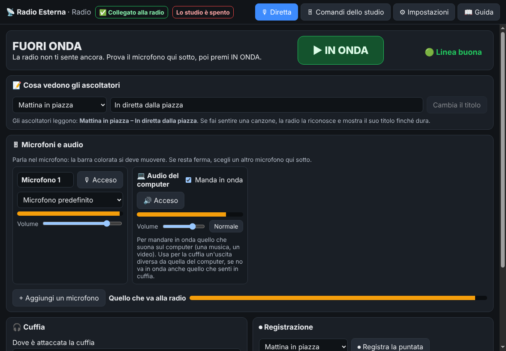

**Installarla** (una volta sola). Apri la pagina delle [release](https://github.com/crybakk/radiosoftware/releases)
e, nell'ultima che contiene l'app, scarica:

- **Windows:** **RadioEsterna-Setup-<versione>.exe**. Avvialo; se Windows avvisa che il programma non è firmato:
  "Ulteriori informazioni" → "Esegui comunque".
- **Mac** (macOS 13 o più nuovo): **RadioEsterna-<versione>-mac-arm64.dmg** per i Mac con chip Apple (M1, M2…),
  **…-mac-x64.dmg** per i Mac Intel (menu  → **Informazioni su questo Mac** → "Chip" o "Processore"). Apri il file
  e trascina **Radio Esterna** in **Applicazioni**. La prima volta il Mac dice che non può verificare lo
  sviluppatore (l'app non è firmata da Apple): premi **Fine**, poi apri **Impostazioni di Sistema** → **Privacy e
  sicurezza**, scorri in fondo e premi **Apri comunque** accanto a "Radio Esterna"; conferma con la password del Mac.
  Si fa una volta sola. Al primo uso il Mac chiede anche il permesso per il **microfono** (e, se accendi l'audio del
  computer, per la **registrazione dello schermo e dell'audio**): rispondi **Consenti**.

Al primo avvio chiede la **chiave di attivazione**, la stessa della regia e del server. Poi scrivi gli stessi
dati che usi per il pannello dal browser: l'**indirizzo della radio** (quello della barra del browser, anche senza
`https://`), il tuo **nome** e la tua **password**. Serve il ruolo **conduttore** o **amministratore**. Se
qualcosa non va, l'app dice cosa fare (per esempio "Nome o password sbagliati"). Le volte dopo entra da sola.

In alto vedi sempre due scritte: **✅ Collegato alla radio** (o **⏳ Mi collego alla radio…**) e **Lo studio è
acceso** o **spento**. Se internet cade, una striscia gialla dice cosa succede e l'app riprova da sola.

**Andare in onda**, scheda **🎙 Diretta**:

1. Appena entri sei **FUORI ONDA**: la radio continua con lo studio (o con la musica di riserva). Parla nel
   microfono: la barra colorata sotto **Microfoni e audio** si deve muovere. Se resta ferma, scegli un altro
   microfono nell'elenco. Lo studio intanto vede che sei pronto e può ascoltarti con **🎧 Ascolta chi è fuori**.
2. **Cosa vedono gli ascoltatori:** scegli il **programma** e, se vuoi, scrivi una riga (es. "In diretta dalla
   piazza"), poi **Cambia il titolo**. Se fai sentire una canzone, la radio la riconosce e mostra il suo titolo
   finché dura.
3. Premi il tasto verde **▶ IN ONDA**: la radio ti sente al posto dello studio. Non serve che lo studio accetti.
4. Quando hai finito premi **⏹ FUORI ONDA** e poi **Sì, FUORI ONDA** (con **No, resto in onda** torni indietro):
   la radio torna allo studio. L'app resta collegata, così puoi rientrare quando vuoi.

**Il pallino della linea**, accanto al tasto, dice com'è la tua linea: 🟢 **Linea buona**; 🟡 **Linea debole**;
🔴 **Linea molto debole: l'audio salta**; ⚫ **L'audio non arriva**. Non c'è niente da regolare: l'app e la radio
si adattano da sole. Se è giallo o rosso l'app ti suggerisce cosa fare: avvicinati al router o usa il cavo di
rete, spostati dove il telefono ha più tacche, chiudi i programmi che usano internet. Lo stesso pallino lo vedono
lo studio e il pannello.

Se internet cade mentre sei in onda, la radio torna allo studio; se internet torna entro 10 minuti rientri in onda
da solo. Se chiudi l'app mentre sei in onda, ti chiede conferma; dopo un minuto la radio torna allo studio.

**Microfoni e audio:** puoi usare fino a **4 microfoni** (**+ Aggiungi un microfono**; **Togli questo
microfono** chiede conferma) e l'**audio del computer** (spunta **Manda in onda** per mandare una musica o un
video del computer). Ognuno ha il suo **Volume** e il tasto **🎙 Acceso** / **🔇 Spento: premi per accendere**. Se
hai spostato un volume, **Normale** lo rimette com'era. In fondo, **Quello che va alla radio** mostra il livello
finale; se compare "Troppo forte" abbassa un po' i volumi. Sul Mac l'audio del computer richiede macOS 13 o più
nuovo.

**Cuffia:** scegli **dove è attaccata la cuffia** e il **volume della tua voce in cuffia**. Con **Senti lo studio
in cuffia** senti lo studio e chi parla dal pannello, così potete parlarvi (quasi senza ritardo). Usa per la cuffia
un'uscita diversa da quella del computer: se no, con l'audio del computer acceso va in onda anche quello che senti
in cuffia.

**Registrazione:**

- **Registra la puntata**: scegli il programma e premi **⏺ Registra la puntata**. La puntata si salva sulla radio
  e, per sicurezza, anche sul computer, come i programmi dallo studio
  ([sezione 13](#programmi-fatti-dallo-studio)). Comincia da sola quando premi IN ONDA. Alla fine premi **⏹
  Programma finito** e conferma: la puntata si pubblica da sola (se il collegamento è caduto la trovi in "Puntate
  da rivedere" nel pannello). La registrazione non parte da sola all'orario del programma: va avviata dall'app.
- **💾 Registra solo sul computer**: un file sul computer, senza puntata sulla radio (**Apri la cartella** per
  trovarlo).

**Comandi dello studio:** è il pannello della radio dentro l'app (playlist, microfono, eventi…), con il tuo utente,
per comandare lo studio da fuori. **📖 Guida** apre questa guida.

**Impostazioni:**

- **Chi sei**: con che nome sei entrato; **Esci** (chiede conferma, non si può mentre sei in onda).
- **Testo grande**: scritte e pulsanti più grandi in tutta l'app.
- **Aggiornamenti**: l'app non si aggiorna mai da sola. **Controlla se ci sono aggiornamenti**; se c'è una
  versione nuova vedi cosa cambia e su Windows **Aggiorna adesso** (l'app si chiude e si riapre in un minuto), sul
  Mac **Scarica la versione nuova** (da installare come la prima volta). Mentre sei in onda non si aggiorna.
- **Avanzate**: **Mostra le regolazioni avanzate** fa comparire le cose tecniche che di solito non servono:
  qualità dell'invio (più bassa se internet è molto lento), cartella delle registrazioni sul computer, quale
  ingresso della scheda audio usare (utile con una scheda a due ingressi), volumi in dB, il limitatore, il segno
  d'inizio della puntata (**📍 Segna inizio**) e i numeri della linea.

**In regia e nel pannello** compare il riquadro di chi è fuori: **Si sta collegando da fuori…**, **Collegato da
fuori e pronto: non è ancora in onda** o **🔴 In onda da fuori**, con il nome, il titolo, il pallino della linea e
il tasto **🎧 Ascolta chi è fuori (solo tu)**: lo senti solo tu, non va alla radio.

### Con un'app Icecast (BUTT, Larix…)

**Cosa ti serve:** l'app, internet (anche quella del telefono) e questi dati:

| Nell'app | Cosa scrivere |
|---|---|
| Tipo di server | **Icecast** |
| Server (indirizzo) | l'indirizzo della radio, oggi `player.radioattivainformazione.it` (senza `https://`) |
| Porta | **9010** |
| Mount (punto di montaggio) | **/** (una barra sola) |
| Utente | **esterna** |
| Password | quella delle dirette esterne (vedi sotto) |

Mount e utente si vedono anche nel pannello: menu **☰** → **Impostazioni server** → **Dirette esterne**.

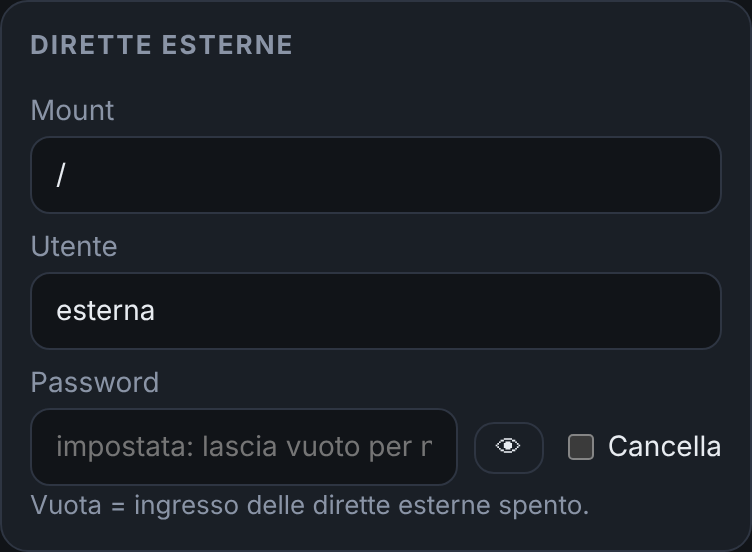

**Dove trovo la password?** L'ha stampata l'installazione del server, al punto 5 ("Dirette esterne"). Nel pannello
le password non si vedono: se non la ricordi, scrivine una nuova nel campo **Password** (con 👁 vedi cosa
scrivi), premi **Salva e applica** e mettila nell'app. Attenzione: salvando, la radio resta muta per qualche
secondo, quindi fallo quando non sei in diretta. Si scrive una volta sola nell'app, poi resta salvata.

### Con BUTT (computer)

1. Apri BUTT → **Settings** → scheda **Main** → sotto **Server** premi **ADD**.
2. Compila: **Name** "Radio" (un nome a piacere), **Address** l'indirizzo della radio, **Port** 9010,
   **Password** la password, **Type** IceCast, **IceCast mountpoint** `/`, **IceCast user** `esterna`. Premi
   **ADD**.
3. Nella scheda **Audio** scegli il microfono o il mixer da cui arriva il suono.
4. Quando vuoi andare in onda premi **▶** (play) nella finestra di BUTT. Per uscire premi **■**.

Nelle altre app (Larix, Luci Live…) i campi hanno nomi simili: scegli il tipo Icecast e metti gli stessi dati.

### Cosa succede quando ti colleghi

Con BUTT, Larix e le altre app Icecast (con Radio Esterna vedi [sopra](#con-lapp-radio-esterna)):

- **Appena l'app si collega sei in onda**, con una breve dissolvenza, al posto della regia (e anche della diretta
  autonoma). Non c'è una "prova" prima: collegati quando vuoi davvero andare in onda.
- Ricevi una **notifica** all'inizio e alla fine (Telegram o email, se attive).
- Quando **scolleghi** l'app torna da sola la regia. Se la regia è spenta, torna la musica di riserva.
- Se internet cade per un momento, l'app di solito si ricollega da sola; nel frattempo va in onda la regia o la
  musica di riserva.
- **Titolo**: se l'app manda il suo titolo (in BUTT il nome della canzone, "Song"), va in onda quello. Se non manda
  niente, dopo 5 secondi va il **titolo parlato** (nome del programma e conduttore,
  [vedi sopra](#titolo-quando-si-parla)), tranne mentre suona un brano riconosciuto.
- Dallo studio o dal telefono puoi **parlare sopra** la diretta esterna con il microfono del pannello
  ([sezione 5](#5-parlare-in-diretta-dal-pannello)).
- In cuffia ascolta l'app o il mixer, **non la radio**: la radio arriva con qualche secondo di ritardo e ti
  confonde.

### I brani vengono riconosciuti da soli

Durante l'esterna il server ascolta il programma e **riconosce i brani**, così finiscono nel registro (fonte
**Esterna**) e nel report SIAE senza scrivere nulla.

- Li confronta con le **impronte audio** della libreria della regia, senza servizi esterni. Le impronte le calcola
  la regia (scheda **Libreria**, riga "Impronte audio", circa mezzo secondo a brano) e le manda al server di notte
  insieme alla libreria (circa 5 KB a brano, la prima volta circa 100 MB per 20.000 brani, dentro il limite di MB
  del giorno). Funziona anche con la regia spenta.
- Un brano è riconosciuto dopo circa 20 secondi, anche se qualcuno ci parla sopra un po'. Riconosce anche i brani
  che non sono nella libreria del server (live, sotto i 192 kbps), perché le impronte sono di tutta la musica.
- **Brani sconosciuti:** se per almeno un minuto non riconosce nulla, il server salva **20 secondi di audio**. Con
  il [bot Telegram della radio](#bot-telegram-della-radio) arriva subito l'audio nella chat; senza il bot arriva
  una notifica (al massimo una ogni mezz'ora). Nel pannello, riquadro **Brani sconosciuti delle esterne**, lo
  ascolti e scrivi titolo, interprete, autori ed editore: da quel momento viene riconosciuto da solo e i passaggi
  già sentiti vanno nel registro. Se era parlato o rumore, premi **Non è musica**. Per etichettare serve almeno il
  ruolo conduttore. I segni `=`, `+`, `-` e `@` all'inizio di un campo vengono tolti, perché Excel li leggerebbe
  come formule quando apri il registro.
- Un brano sconosciuto entra nel registro solo dopo che lo hai etichettato.
- Per spegnere il riconoscimento: pannello, menu **☰** → **Impostazioni server** → **Riconoscimento brani e
  puntate**.

Se l'app non si collega, guarda [Problemi comuni, dirette esterne](#dirette-esterne).

## 4. Il pannello dal telefono

Il pannello comanda la regia dal browser, da qualsiasi posto: telefono, tablet o computer. Si adatta da solo
allo schermo: sul telefono i riquadri stanno uno sotto l'altro; sul computer (schermo largo) stanno su tre
colonne, con il brano in onda accanto a **PLAY / AVANTI / STOP**, così vedi quasi tutto senza scorrere.

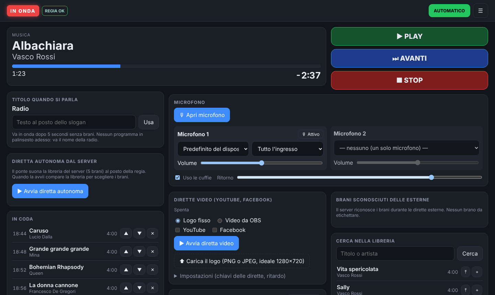

**Aprirlo:** scrivi nel browser l'indirizzo della radio con `https://` davanti e `/dashboard` in fondo (durante le
prove: `https://player.radioattivainformazione.it:9443/dashboard`). L'indirizzo senza `/dashboard` apre invece il
player per gli ascoltatori ([sezione 13](#13-programmi-puntate-e-repliche)). Entra con il tuo nome e la tua password (la prima volta
`admin` e la password stampata dall'installazione).

La **prima volta** che entri compaiono alcune schede di benvenuto, diverse secondo il ruolo: cosa va in onda,
come si comanda, dove si trova il menu. Passi con **Avanti →**, chiudi con **Salta** o **Inizia**. Non
ricompaiono più da sole; per rivederle: menu **☰ → 👋 Benvenuto**.

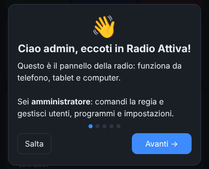

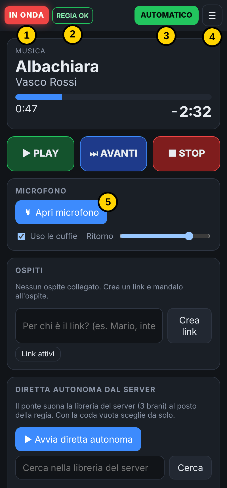

1. Spia **IN ONDA / FERMO** della regia.
2. **REGIA OK** se la regia è collegata, **REGIA SCOLLEGATA** se è spenta o senza internet.
3. **AUTOMATICO / MANUALE**, come in regia.
4. Menu **☰**: **Programmi**, **Ascoltatori**, **Annunci vocali**, **Utenti**, **Impostazioni server**,
   **📖 Guida**, **👋 Benvenuto**, **📻 Player pubblico** ed **Esci** (alcune voci solo per gli amministratori). Da ogni sezione
   torni alla schermata principale con **← Panoramica** (in alto a sinistra) o con il tasto indietro del telefono.

   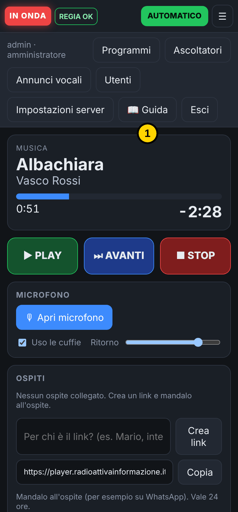

5. **🎙 Apri microfono**: parli in diretta ([sezione 5](#5-parlare-in-diretta-dal-pannello)).

Sotto trovi il brano in onda con il tempo che manca (rosso negli ultimi 10 secondi), **PLAY**, **AVANTI** e
**STOP** (fanno esattamente quello che fanno in regia), la coda (frecce per spostare, ✕ per togliere), la
ricerca (⤒ mette il brano come prossimo, + lo aggiunge in fondo) e i jingle con **Ferma jingle**.

Se il server segnala un problema, lo vedi in una striscia rossa in alto. Chi ha il ruolo **Ospite** vede tutto
ma non può comandare.

## 5. Parlare in diretta dal pannello

Conduttori e amministratori possono parlare in diretta dal pannello, da casa o da fuori, senza passare dal PC
della regia. La voce si somma al programma che va in onda (regia, diretta esterna o diretta autonoma).

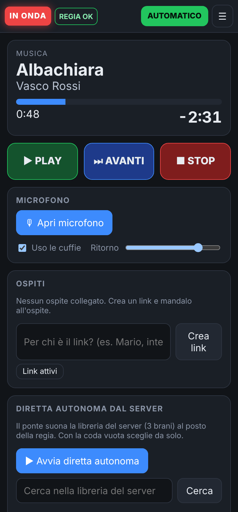

1. Collega le **cuffie** e premi **🎙 Apri microfono**. Il browser chiede il permesso del microfono: rispondi sì.
   In cuffia senti il programma quasi senza ritardo, ma **non sei ancora in onda**. La barra mostra il livello:
   verde va bene, gialla è forte, rossa è troppo forte.
2. Premi **VAI IN ONDA**: la musica si abbassa (di 12 dB) e sei in onda. Il tasto diventa rosso con scritto
   **IN ONDA**. In cuffia senti il programma senza la tua voce, così non c'è eco.
3. Premi di nuovo il tasto rosso per uscire dall'onda: la musica torna su. **Chiudi microfono** spegne tutto.

Da sapere:

- funziona solo con il pannello aperto in **https**;
- il microfono del pannello lo apre una persona alla volta: se è già aperto da un altro, vedi chi lo sta usando;
- se la connessione cade o chiudi la pagina, esci dall'onda da solo;
- la voce va in onda solo se c'è un programma (regia, esterna o diretta autonoma), non sopra la musica di
  riserva. Con la regia spenta avvia la [diretta autonoma](#7-diretta-autonoma-senza-la-regia) e parla sopra;
- **Uso le cuffie**: lascialo spuntato. Senza cuffie toglilo prima di aprire il microfono (la voce suona un po'
  meno naturale, ma niente eco);
- **Ritorno**: il volume del programma in cuffia.

### Due microfoni insieme

Dal pannello puoi andare in onda con **due microfoni** sullo stesso telefono o computer, per esempio conduttore e
ospite seduti vicini.

1. Collega i due microfoni: due **microfoni USB**, oppure una **scheda audio con 2 ingressi** (i microfoni nei
   suoi ingressi 1 e 2).
2. In **Microfono 1** scegli l'ingresso. In **Microfono 2** scegli l'altro: all'inizio c'è scritto *nessuno*.
   - Con due microfoni USB scegli i due nomi e lascia **Tutto l'ingresso**.
   - Con una scheda a 2 ingressi scegli la scheda in tutti e due, poi **Solo canale 1** nel primo e
     **Solo canale 2** nel secondo.
3. Premi **🎙 Apri microfono**: ogni microfono ha la sua barra del livello.
4. Con **Volume** regoli ogni microfono, con **🎙 Attivo / 🔇 Muto** lo togli e lo rimetti in onda (per esempio
   se l'ospite tossisce). Si può fare anche mentre sei in onda.

Da sapere:

- per cambiare ingresso o canale chiudi e riapri il microfono; volume e muto invece cambiano subito;
- la barra grande in alto è il totale, cioè quello che va in onda;
- con **Solo canale 1/2** il browser non toglie l'eco: usa le cuffie;
- le scelte restano salvate in quel browser;
- sul telefono di solito c'è un ingresso solo: due microfoni servono soprattutto dal computer.

## 6. Ospiti in diretta

Fino a **3 ospiti** possono parlare in diretta da casa, con il telefono o il computer, senza installare nulla.

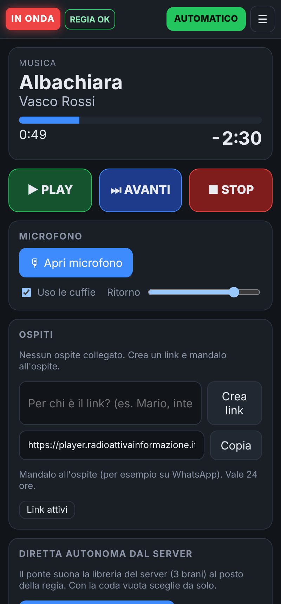

1. Nel pannello, riquadro **Ospiti**, scrivi per chi è il link (es. "Mario, intervista delle 18") e premi
   **Crea link**. Premi **Copia** (o **Invia…** dal telefono) e mandalo all'ospite, per esempio su WhatsApp. Il
   link vale 24 ore; da **Link attivi** puoi copiarlo di nuovo o **revocarlo**.
2. L'ospite apre il link, scrive il nome, prova il microfono (la barra deve muoversi) e preme **Entra in sala
   d'attesa**. Intanto sente la radio.

   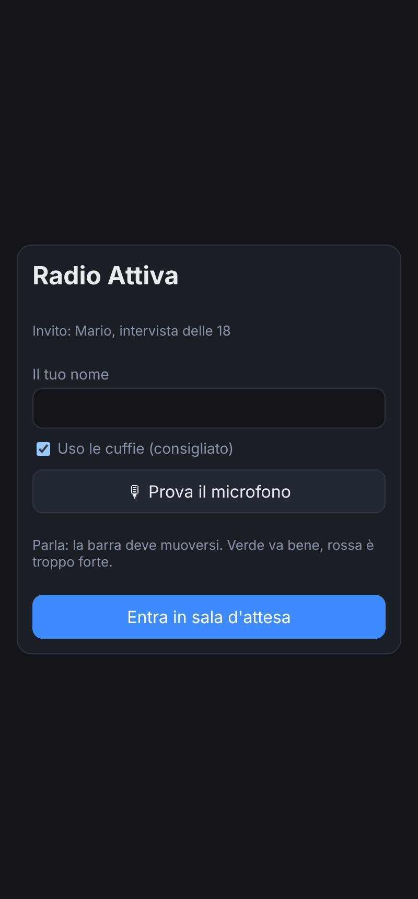

3. Nel pannello compare l'ospite "in sala d'attesa": premi **Fai entrare** (o **Rifiuta**).
4. Quando l'audio è collegato premi **Metti in onda**: la musica si abbassa e l'ospite è in onda (sulla sua
   pagina compare **IN ONDA** in rosso). Premi di nuovo per toglierlo dall'onda, **Chiudi** per salutarlo.

Ognuno sente in cuffia la radio e le altre voci in onda, ma non la propria. Consiglia all'ospite le **cuffie**:
senza, deve togliere la spunta "Uso le cuffie" prima di entrare. Se l'ospite chiude la pagina o perde la
connessione esce dall'onda da solo; riaprendo lo stesso link torna in sala d'attesa.

## 7. Diretta autonoma, senza la regia

Per andare in onda **senza la regia**, per esempio da fuori con il solo telefono: il server suona la musica che ha
nella sua libreria e tu ci parli sopra con il microfono del pannello.

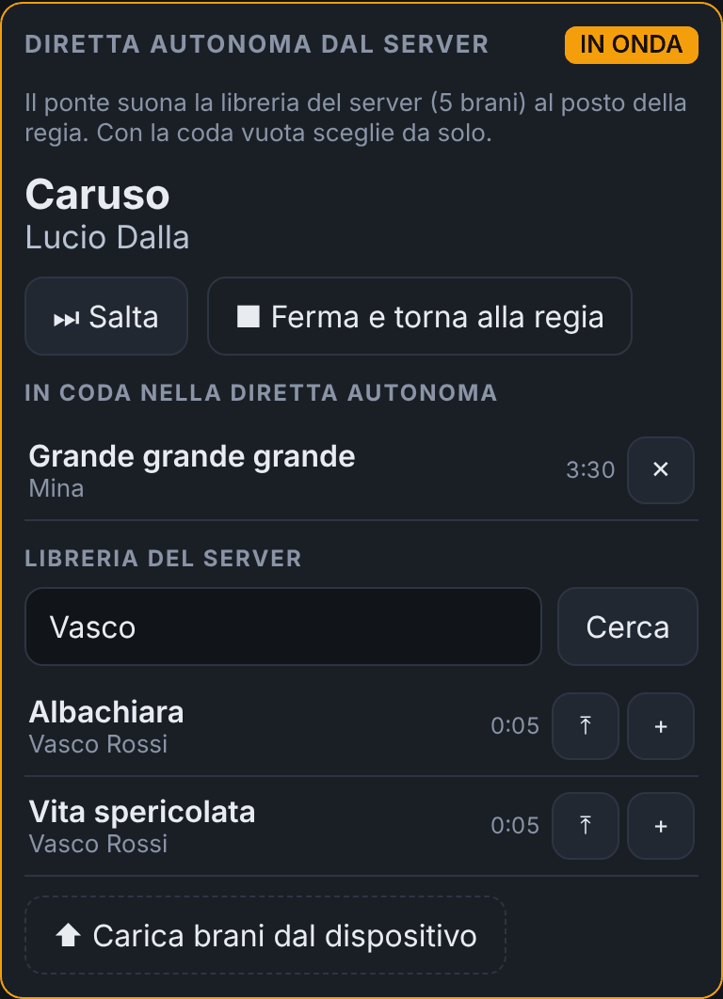

- **▶ Avvia diretta autonoma**: la musica del server va in onda **al posto della regia** (la regia può restare
  accesa, ma non si sente). Se si collega una diretta esterna, ha la precedenza lei. Finché non la avvii il
  riquadro mostra solo questo pulsante: coda e libreria del server compaiono quando sei in diretta autonoma.
- **Cerca nella libreria del server**: ⤒ mette il brano come prossimo, + lo aggiunge in fondo. Con la coda vuota
  il server sceglie da solo, senza ripetere troppo presto lo stesso brano o artista.
- **⬆ Carica brani dal dispositivo**: scegli uno o più file dal telefono o dal computer; vanno sul server e in
  coda. Se la libreria del server è vuota il pulsante c'è anche prima di avviare, per caricare i primi brani. Di notte scendono anche nella regia ([sezione 22](#22-la-musica-sul-server)).
- **⏭ Salta** passa al brano successivo; **■ Ferma e torna alla regia** chiude la diretta autonoma.

Il brano successivo si decide circa 20 secondi prima della fine di quello in onda: fino ad allora puoi cambiare la
coda. Tra un brano e l'altro non c'è dissolvenza. Inizio e fine arrivano come notifica, con il nome di chi l'ha
avviata. Gli ospiti del pannello vedono cosa suona ma non la comandano.

## 8. Eventi a orario

Un evento fa una serie di cose, in ordine, a un orario. Il modo più semplice: scheda **Eventi** → premi uno degli
**eventi già pronti** (**🔔 Jingle a ogni ora**, **🕐 Ora esatta con la voce**, **📰 Notiziario a ogni ora**,
**🔁 Replica di un programma**): si apre l'evento già compilato, controlla e premi **Salva**. Per farne uno da zero:
**+ Nuovo evento**. **Elimina** chiede conferma. Le azioni **Comando esterno** e **Flusso esterno** compaiono solo con
**Mostra le cose avanzate**.

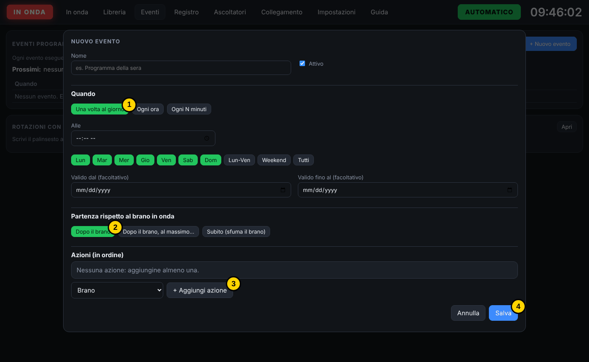

1. **Quando**: **Una volta al giorno**, **Ogni ora** (al minuto scelto) oppure **Ogni N minuti** (da un orario a
   un altro). Sotto scegli i giorni (scorciatoie Lun-Ven, Weekend, Tutti) e, se serve, le date di validità.
2. **Partenza**: **Dopo il brano** aspetta che finisca il brano in onda; **Dopo il brano, al massimo…** aspetta ma
   sfuma il brano dopo i secondi indicati; **Subito (sfuma il brano)** parte all'orario esatto.
3. **Azioni**: scegli l'azione dall'elenco e premi **+ Aggiungi azione** (anche più di una).
4. **Salva**.

| Azione | Cosa fa |
|---|---|
| Brano | un brano preciso |
| Brano casuale | un brano a caso per tipo, genere o cartella (es. un jingle) |
| Playlist | una playlist M3U/PLS o una cartella: subito prima della coda, in fondo, oppure al posto della coda |
| Flusso esterno | un flusso internet per N minuti |
| Automatico / manuale | cambia modalità |
| Svuota coda | toglie i brani in coda |
| Ferma tutto | ferma la messa in onda |
| Regole di rotazione | da quel momento la rotazione usa solo certi generi, anni o una fascia di **energia** (es. "dalle 22 musica tranquilla, energia 2-5"); "Torna alla rotazione normale" la riporta come prima |
| Comando esterno | avvia un programma o uno script sul PC |
| Replica di un programma | l'ultima puntata pubblicata del programma ([sezione 13](#13-programmi-puntate-e-repliche)) |
| Notiziario | l'ultima edizione di un notiziario scaricato da internet ([Notiziari](#notiziari)) |
| Annuncio vocale | un testo letto dalla voce sintetica ([Voce sintetica](#voce-sintetica)) |
| Mix DJ | accende o spegne i cambi a tempo in automatico ([Mix DJ](#mix-dj-cambi-a-tempo)); resta così fino a un evento che lo cambia |

Con **▶ Prova** esegui subito un evento per vedere come va. **Duplica** crea una copia da modificare. In alto vedi
i prossimi eventi e, se attivo, il profilo di rotazione in uso.

### Eventi e rotazioni da remoto

Con la regia accesa e collegata al server, eventi e rotazioni si comandano anche da fuori studio:

- **Pannello** → menu ☰ → **Eventi e rotazioni**: prossimi eventi, elenco, **▶ Esegui ora**, rotazione attiva da
  cambiare al volo (**Usa questa** / **Torna alla normale**) e regole generali. Gli amministratori creano, modificano,
  duplicano, accendono, spengono ed eliminano gli eventi con le stesse azioni della regia e preparano le
  [rotazioni con l'AI](#10-rotazioni-con-lai) (l'AI lavora sul PC di regia: puoi chiudere la pagina, il risultato resta lì).
- **Bot Telegram della radio**: sezioni **📅 Eventi** e **🔁 Rotazione** ([Bot Telegram](#bot-telegram-della-radio)).

| Chi | Cosa può fare |
|---|---|
| Ospite del pannello | vedere eventi e rotazione |
| Conduttore | in più: esegui ora, cambia rotazione |
| Amministratore | tutto: modifica eventi, regole e rotazioni con l'AI |
| Chi è nella chat del bot | accendere e spegnere eventi, esegui ora (con conferma), cambiare rotazione |

Gli eventi con un **Comando esterno** (🔒) da remoto si vedono soltanto: per sicurezza si creano e si cambiano solo in regia.
Gli orari sono quelli del PC di regia.

## 9. Libreria e scheda brano

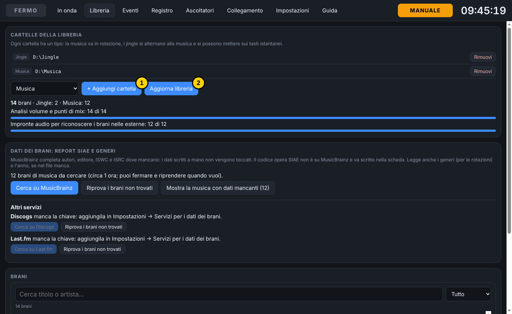

1. **+ Aggiungi cartella**: prima scegli il tipo (Musica, Jingle, Notiziario, Programma, Spot), poi la cartella.
   I collegamenti (scorciatoie, link simbolici, junction) dentro la cartella non vengono seguiti: aggiungi la
   cartella vera.
2. **Aggiorna libreria**: legge i file nuovi o cambiati (titolo, interprete, autori, editore, ISRC). Premilo ogni
   volta che aggiungi file nelle cartelle.

In sottofondo parte l'**analisi**: livella il volume di tutti i brani, trova dove inizia e finisce l'audio utile e
dove far partire il brano successivo. Con 20.000 brani ci vuole un po', ma puoi andare in onda subito.

Dopo le impronte audio parte l'**analisi per il Mix DJ** (riga "Analisi per il Mix DJ"): per ogni brano di musica
trova i **BPM** e i battiti, il primo tempo della battuta, la **tonalità**, l'**energia** (da 1 a 10), dove finisce
l'**intro** e dove inizia l'**outro**. Ci vogliono alcuni secondi a brano: con 20.000 brani circa un giorno, in
sottofondo e solo mentre la regia è aperta (riprende da dove era rimasta). Non esiste un archivio online con questi
dati, per questo li calcola la regia. I risultati si vedono in fondo alla scheda del brano. Dopo l'aggiornamento
del 25/11/2026 la regia rifà questa analisi su tutti i brani, per trovare l'inizio di ogni battuta: finché un brano
non è rianalizzato il Mix DJ usa i dati di prima. Se un brano non ha un
ritmo regolare (classica, live, tempi liberi) la scheda lo dice: in quel caso il cambio sarà la dissolvenza normale.

Senza le cose avanzate tutto questo lavoro si vede come una sola riga: **La regia sta preparando i brani: 45%**. Le
righe separate, e i riquadri **Dati dei brani** (MusicBrainz), **Pulizia** e **Categorie**, compaiono con
**Impostazioni** → **Mostra le cose avanzate**.

Sotto c'è l'elenco dei brani. **Scheda** apre la scheda del brano, dove puoi:

- correggere titolo, interprete, album, anno, genere e tipo (se cambi titolo o interprete, i dati di MusicBrainz e
  degli altri servizi si cercano di nuovo per il brano corretto);
- aprire **Dati per la SIAE e dati tecnici** per scrivere **autori/compositori**, **editore** e **codice opera
  SIAE** (servono per il report SIAE) o spostare inizio, fine e punto di mix se l'analisi automatica non ti convince;
- togliere **Può andare in onda** per escludere un brano da rotazione e ricerca senza cancellarlo.

### Brani troppo lunghi (premixati)

La musica più lunga di **10 minuti** (premixati, mix) è **nascosta**: non compare nella libreria e nelle ricerche,
non va in rotazione, nelle rotazioni con l'AI, negli eventi, sul server, nella diretta autonoma e nella musica di
emergenza. I file restano dove sono: se alzi il limite ricompaiono da soli. Sopra l'elenco la regia ti dice quanti
brani sono nascosti. Jingle, notiziari e programmi non hanno limite.

Il limite si cambia dal pannello: menu **☰** → **Impostazioni server** → **Radio** → **Durata massima dei brani
(minuti)** (0 = nessun limite). La regia lo riceve dal server in pochi secondi.

### Parti che non sono musica (tagliate da sole)

All'inizio e alla fine di molti brani ci sono cose che non sono musica: **silenzio**, una **presentazione parlata**,
**applausi** e pubblico dei live, **rumore**, oppure una **traccia fantasma** che parte dopo minuti di silenzio.
L'analisi della Libreria le trova da sola e sposta l'**inizio** e la **fine** del brano: in onda si sente solo la
musica, in regia, nella diretta autonoma e nella musica di emergenza del server. **I file non vengono toccati.**

Per non sbagliare, la regia taglia solo all'inizio e alla fine (mai in mezzo), al massimo 45 secondi all'inizio e
90 alla fine (il silenzio puro si toglie sempre), e confronta ogni pezzo con il resto del brano: una canzone tutta
voce e chitarra non viene scambiata per parlato. Se un taglio non ti convince, apri il brano → **Dati per la SIAE e
dati tecnici** e sposta inizio e fine a mano: le tue correzioni restano.

Dopo l'aggiornamento la regia rianalizza da sola, in background, tutta la musica già in libreria (qualche ora per
migliaia di brani); poi rifà l'analisi del Mix DJ dei brani che hanno cambiato inizio o fine.

### Brani troppo corti (durata minima)

I brani con meno di **2 minuti di musica** (intro, interludi, scenette degli album) restano in libreria e li puoi
mettere a mano, ma **non vengono mai scelti da soli**: né dalle rotazioni, né dai brani a caso degli eventi, né
dalla diretta autonoma o dalla musica di emergenza del server. Conta solo la musica: silenzi, parlato e applausi
tagliati all'inizio e alla fine non valgono. Jingle, notiziari e programmi non hanno limite.

Il limite si cambia dal pannello: menu **☰** → **Impostazioni server** → **Radio** → **Durata minima dei brani
(secondi di musica)** (120 = 2 minuti, 0 = nessun limite). La regia lo riceve dal server in pochi secondi.

Se rinomini un file cambiando solo maiuscole e minuscole (per esempio `canzone.mp3` → `Canzone.mp3`), su Windows
resta lo stesso brano, con correzioni e storico.

### Dati per il report SIAE (MusicBrainz)

Nel riquadro **Dati dei brani: report SIAE e generi**, **Cerca su MusicBrainz** completa da solo i dati che
mancano ai brani di musica: **autori** (separati da virgola), **editore**, **ISWC** (codice dell'opera) e **ISRC**
(codice della registrazione).

- Riempie solo i campi vuoti: quello che hai scritto a mano non viene mai toccato.
- Accetta un risultato solo se titolo e interprete corrispondono e la durata è simile (massimo 10 secondi di
  differenza), così una versione live o una cover non finiscono sul brano sbagliato.
- Ci vogliono circa **12 ore** per 20.000 brani (MusicBrainz risponde a una domanda al secondo). Si può fermare e
  riprendere quando vuoi. Usa internet: meglio di notte o con una rete senza limiti.
- Legge anche i **generi** ufficiali (per le regole di rotazione e per le [rotazioni con l'AI](#10-rotazioni-con-lai))
  e l'**anno** della prima uscita, se nel file manca. Se il brano non ha generi prende quelli dell'artista. I
  generi compaiono nella scheda brano e valgono insieme al genere scritto nel file. Dopo l'aggiornamento la ricerca
  va rifatta una volta su tutta la musica (per i brani già trovati basta una richiesta: circa 6 ore per 20.000).
- Il **codice opera SIAE** non è su MusicBrainz: va scritto nella scheda brano.
- **Riprova i brani non trovati** rimette in coda quelli ancora incompleti (utile dopo qualche mese).
- **Mostra la musica con dati mancanti** elenca i brani senza autori, editore o codici: con **Scheda** li completi.
- MusicBrainz chiede un contatto a chi usa il servizio: scrivi la tua email in **Impostazioni** → **Servizi per i dati dei brani** → **Contatto per MusicBrainz** e premi **Salva**. Viene mandata solo a MusicBrainz.

### Discogs, Last.fm e AcoustID

Tre servizi gratuiti che aggiungono altri dati. Ognuno vuole una chiave personale, che si crea una volta sola dal
sito e si incolla in **Impostazioni** → **Servizi per i dati dei brani** (sotto ogni campo c'è il link giusto),
poi **Salva**.

| Servizio | Cosa aggiunge | Dove si crea la chiave |
|---|---|---|
| **Discogs** | generi e stili dettagliati (es. "rock", "pop rock", "ballad") | discogs.com → Impostazioni → Developers → **Generate new token** |
| **Last.fm** | etichette scelte dagli ascoltatori: carattere e decennio (es. "chill", "80s", "italian") | last.fm/api/account/create → copia la **API key** |
| **AcoustID** | riconosce il brano **dall'audio** quando MusicBrainz non lo trova per titolo | acoustid.org/new-application → copia la **API key** |

Poi, in **Libreria**:

- **Cerca su Discogs** (circa 6 ore per 20.000 brani) e **Cerca su Last.fm** (circa 2 ore) partono quando vuoi, si
  fermano e riprendono da dove erano rimasti;
- **AcoustID** non ha un pulsante suo: con la chiave salvata, **Cerca su MusicBrainz** prova dall'audio i brani che
  non trova per titolo, una volta sola per brano;
- **Riprova i brani non trovati** rimette in coda quelli senza risultato.

Generi ed etichette di tutti i servizi compaiono nella scheda brano e valgono nelle regole di rotazione, nel
**Brano casuale** e nelle rotazioni con l'AI.

Se un servizio risponde "occupato" (errore 503) la regia riprova da sola più volte. Se continua, la ricerca va
**in pausa** e riparte da sola dopo qualche minuto (il riquadro dice a che ora); si ferma solo se il servizio non
risponde per più di mezz'ora.

### Categorie ed etichette tue

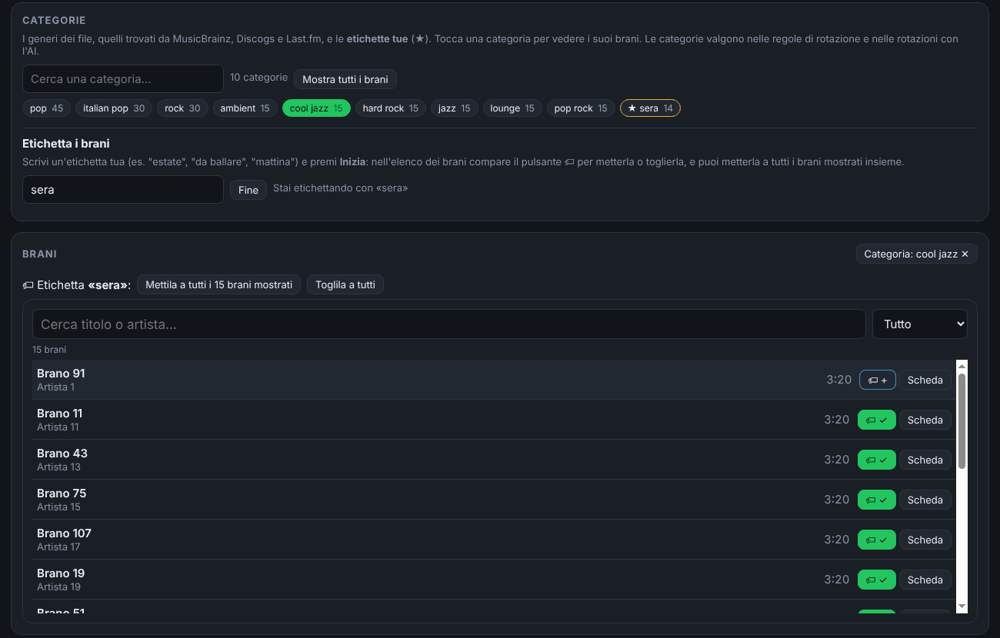

Nel riquadro **Categorie** della **Libreria** vedi tutte le categorie della musica, con il numero di brani:
i generi dei file, quelli di MusicBrainz, Discogs e Last.fm, e le **etichette tue** (con la ★).

1. Tocca una categoria: l'elenco **Brani** mostra solo i suoi brani (✕ per tornare a tutti).
2. Per mettere un'etichetta tua (es. "sera", "estate", "da ballare"): scrivila in **Etichetta i brani** e premi
   **Inizia**.
3. Nell'elenco dei brani compare il pulsante **🏷 +**: toccalo per mettere l'etichetta (diventa **🏷 ✓**, toccalo
   di nuovo per toglierla). **Mettila a tutti i … brani mostrati** la mette a tutto l'elenco in una volta: puoi
   prima scegliere una categoria o cercare un artista.
4. **Fine** quando hai finito.

Le etichette tue si vedono e si correggono anche nella **Scheda** del brano (campo **Etichette tue**). Valgono
come i generi: nelle regole di rotazione, nel **Brano casuale** e nelle rotazioni con l'AI. Puoi usarle anche
per filtrare la ricerca dei brani in **In onda**, nei **Jingle istantanei** e negli **Eventi** (menu **Tutte le
categorie**, le tue etichette sono in cima con la ★).

### Pulizia della libreria: brani non radiofonici e doppioni

Nella sezione **Pulizia della libreria** trovi tre elenchi:

- **Da controllare**: i brani che non sembrano adatti alla messa in onda, col motivo: titoli generici ("Track 01",
  "Traccia 3"), live@ e altri live, interviste, nomi di file o registrazioni al posto del titolo ("REC_0012"),
  titoli fatti solo di numeri.
- **Doppioni**: brani con lo stesso artista e titolo (senza badare a maiuscole, accenti e "Remastered"). In ogni
  gruppo la copia con la qualità migliore è segnata **da tenere** e le altre sono già selezionate.
- **Tolti dalla libreria**: quelli che hai tolto, per rimetterli se cambi idea.

Due aiuti in più riempiono **Da controllare** da soli, in background:

- **Live dal suono**: dopo l'analisi e le impronte, la regia ascolta i primi 10 e gli ultimi 12 secondi di ogni
  brano e segnala quelli con almeno 3 secondi di applausi o pubblico. È un indizio: controlla tu.
- **Titoli con l'AI**: premi **Analizza i titoli con l'AI** (serve il modello scaricato in **Rotazioni con l'AI**).
  L'AI legge artista, titolo e cartella di 30 brani alla volta e segnala mix, karaoke, parlato, registrazioni e
  titoli che non sono titoli. Su 20.000 brani ci vogliono alcune ore: puoi fermarla e riprendere, e i brani già
  letti non si rifanno.

Niente si toglie da solo. Seleziona i brani (o **Seleziona tutti**) e scegli:

- **Togli dalla libreria**: il brano non va più in onda, non si trova nella ricerca e sparisce dal server. Il file
  resta sul PC dov'è, e le scansioni non lo rimettono.
- **Togli e sposta il file negli scarti**: come sopra, e il file va nella sottocartella **_Tolti dalla libreria**
  della sua cartella musica (con le stesse sottocartelle). Quando vuoi la cancelli a mano.
- **Va bene così**: il brano resta e non compare più tra quelli da controllare.

Anche nell'elenco **Brani** puoi selezionare più brani e toglierli insieme. Con **Filtri** cerchi per titolo,
artista, album, genere o anno e scegli l'ordine.

Se togli più di 20 brani in una volta, la regia non li cancella dal server finché non premi **Conferma
cancellazioni** (Collegamento → Libreria sul server).

## 10. Rotazioni con l'AI

Invece di creare a mano gli eventi **Regole di rotazione** fascia per fascia, scrivi il palinsesto a parole e li
prepara l'AI. L'AI gira sul PC di regia, senza internet e gratis: serve solo scaricare il modello la prima volta.

1. Scheda **Eventi** → riquadro **Rotazioni con l'AI** → **Apri**.
2. La prima volta premi **Scarica il modello** (Qwen3 4B Instruct, circa 2,5 GB). Se si interrompe, **Riprendi lo
   scaricamento** riparte da dove era arrivato.
3. Scrivi il **Palinsesto**, per esempio: *"Dal lunedì al venerdì dalle 7 alle 10 pop italiano allegro, dalle 10
   alle 13 successi degli anni 80 e 90. Tutti i giorni dalle 22 alle 2 musica tranquilla, jazz e lounge. Sabato e
   domenica dalle 9 alle 12 rock, con un jingle ogni 3 brani."* (**Usa l'esempio** lo scrive per te).
4. **Prepara le fasce**: da meno di un minuto a qualche minuto. La messa in onda continua normalmente.
5. Nell'**Anteprima** controlla ogni fascia: giorni, orari, generi, anni, separazione artista, jingle e quanti
   **Brani** ci rientrano. Puoi correggere tutto o togliere una fascia con ✕. Una fascia con meno di 10 brani (⚠)
   userebbe tutta la musica.
6. **Crea gli eventi**: per ogni fascia nasce un evento all'inizio e uno che torna alla rotazione normale alla
   fine. Si chiamano **AI · …** e si modificano come gli altri. Con **Sostituisci gli eventi creati prima dall'AI**
   quelli vecchi vengono tolti, così puoi rifare il palinsesto quante volte vuoi.

L'AI sceglie **solo tra i generi della tua libreria** (del file e dei servizi della [sezione 9](#9-libreria-e-scheda-brano)):
per avere più generi fai prima la ricerca su MusicBrainz. Se propone qualcosa che non c'è, l'anteprima lo toglie e
lo scrive in giallo. Le rotazioni con l'AI valgono solo in regia: la musica di riserva del server resta a caso.

### Farlo preparare a Claude in chat (file .md)

Se l'AI della regia non può girare (PC con poca memoria) o preferisci Claude, usi un file:

1. Scrivi il **Palinsesto** e premi **Esporta per Claude**: la regia salva un file `rotazioni-per-claude_….md` con
   il palinsesto, le regole e i generi della tua libreria.
2. Manda il file a Claude in chat. Lui risponde con il piano.
3. Salva la sua risposta in un file (`.md`, `.txt` o `.json`) e premi **Importa piano**.
4. Le fasce compaiono nella solita **Anteprima**: controlla e premi **Crea gli eventi**.

Gli stessi due tasti ci sono anche nel **pannello** del server (menu ☰ → **Eventi e rotazioni** → **Rotazioni con
l'AI**, per gli amministratori): il file si scarica nel computer o nel telefono da cui stai usando il pannello e il
piano si importa da lì. Serve la regia accesa e collegata, ma **non** serve il modello dell'AI scaricato.

### Energia dei brani

Ogni brano analizzato ha un'**energia** da 1 (molto calmo) a 10 (molto energico), visibile in fondo alla scheda del
brano. La rotazione la usa in due modi:

- **sempre**: tra un brano e il successivo l'energia non salta di più di 2 punti, così non si passa di colpo da una
  ballata a un pezzo da discoteca;
- **per fascia oraria**: nell'azione **Regole di rotazione** di un evento scrivi l'**Energia** da-a (per esempio
  dalle 22 "energia 2-5", dalle 7 "energia 5-8"). Nelle rotazioni con l'AI basta scriverlo nel palinsesto
  ("musica tranquilla", "musica carica") oppure correggerlo nella colonna **Energia** dell'anteprima.

Sono preferenze, non divieti: se in una fascia non ci sono abbastanza brani adatti, la regia sceglie lo stesso e la
radio non resta mai muta. I brani non ancora analizzati vanno sempre bene.

## 11. Registro e report SIAE

La scheda **Registro** elenca tutto quello che è andato in onda, con orario, durata, tipo, titolo, interprete,
autori e codice SIAE. Scegli le date e premi **Esporta CSV** (si apre con Excel). Il registro dice anche quanti
brani non hanno autori o codice SIAE: completali dalla scheda brano.

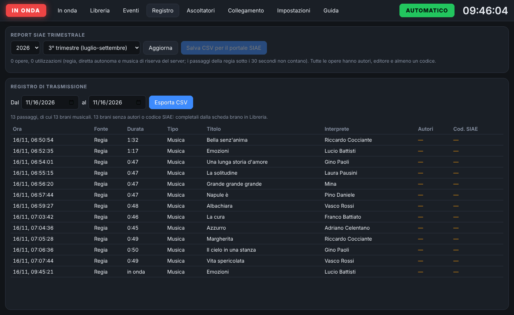

La colonna **Fonte** dice da dove arriva ogni passaggio: **Regia**, **Diretta autonoma**, **Riserva del server** o
**Esterna** (brani riconosciuti). I brani suonati dal server vengono scaricati ogni 10 minuti (e prima di ogni
report) e aggiunti una volta sola.

### Report SIAE trimestrale

In cima alla scheda **Registro** scegli anno e trimestre (di solito è già scelto quello appena finito):

- vedi una riga per opera e interprete con il numero di **passaggi**;
- contano solo i brani di **musica** (niente jingle, spot, notiziari, annunci) di tutte le fonti. I passaggi della
  regia sotto i 30 secondi (brano saltato) non contano;
- valgono i dati attuali della scheda brano, così le correzioni fatte dopo valgono anche per il passato;
- **Solo le opere con dati mancanti** mostra quelle senza autori, editore o codici: completale con **Scheda**.
  "solo server" indica un brano caricato dal pannello che non è nella libreria della regia;
- **Salva CSV per il portale SIAE** crea il file da caricare: separato da punto e virgola, con le colonne TITOLO
  OPERA, AUTORE, EDITORE, INTERPRETE, UTILIZZAZIONI, CODICE OPERA, CODICE ISWC, CODICE ISRC.

Se compare "Brani suonati dal server non aggiornati", il server non era raggiungibile: il report contiene solo i
brani scaricati finora. Riprova con il server collegato.

## 12. Notiziari e voce sintetica

### Notiziari

Per mandare in onda un notiziario preso da internet (per esempio il podcast di un GR) senza scaricarlo a mano.
Solo in regia: il server non manda notiziari.

1. **Impostazioni** → **Notiziari** → **Aggiungi fonte**:
    - **Nome**: come compare nel registro e negli eventi (es. "GR nazionale");
    - **Link**: il feed del podcast (si prende sempre l'ultima puntata) oppure il link diretto a un file audio che
      viene aggiornato a ogni edizione;
    - **Età massima (minuti)**: se l'ultima edizione è più vecchia è "vecchia" (0 = nessun limite);
    - **Se è vecchio o non si scarica**: **Saltalo**, **Manda l'ultimo scaricato**, **Manda un file a scelta**
      oppure **Leggi un testo con la voce sintetica**.
2. **Prova** dice cosa andrebbe in onda; **🎧 Ascolta in preascolto** te lo fa sentire. Poi **Salva**.
3. Scheda **Eventi**: crea un evento (es. **Ogni ora**, minuto 00, **Dopo il brano**) con l'azione **Notiziario**.

All'ora dell'evento la regia scarica l'ultima edizione (solo se è cambiata, per consumare pochi dati con il 4G) e
la mette subito dopo il brano in onda. Nel registro compare come Notiziario, quindi non va nel report SIAE. Se
viene saltato, il motivo compare nella striscia gialla in alto. Prima di ritrasmettere notiziari di altri,
assicurati di avere il loro permesso.

### Voce sintetica

Una voce gratuita legge i tuoi annunci, con l'ora, il brano e il programma inseriti da soli. Funziona senza
internet; serve internet solo la prima volta, per scaricare la voce (circa 65 MB Paola, 30 MB Riccardo).

1. **Impostazioni** → **Voce sintetica**: scegli **Paola** (donna) o **Riccardo** (uomo, qualità più bassa) e, se
   serve, premi **Scarica … adesso**. Scrivi il **Nome della radio**. Regola **Velocità**, **Espressività**,
   **Variazione del ritmo**, **Pausa tra le frasi**, **Tono** e **Volume** (**Valori normali** le rimette come
   all'inizio). Scrivi un testo di prova, premi **🎧 Ascolta in preascolto**, poi **Salva**.
2. Scheda **Eventi**: crea un evento con l'azione **Annuncio vocale** e scrivi il testo. I pulsanti sopra il testo
   inseriscono le parti che si riempiono da sole:

| Nel testo | Diventa |
|---|---|
| `{ora}` | "22 e 50", "23 in punto", "mezzanotte e 5" |
| `{data}` | "sabato 15 novembre" |
| `{radio}` | il nome della radio |
| `{brano}`, `{artista}` | il brano appena andato in onda (o in onda adesso) |
| `{prossimo_brano}`, `{prossimo_artista}` | il brano che viene dopo |
| `{programma}`, `{prossimo_programma}`, `{ora_prossimo_programma}` | dalle fasce dei programmi del server |

Se una parte non si sa (es. nessun brano dopo), la frase viene detta senza. Nel registro l'annuncio compare come
Jingle, quindi non va nel report SIAE.

`{ora}` dice l'ora in cui l'annuncio **va in onda**, non quella in cui scatta l'evento: se l'evento aspetta la fine
del brano in corso (o altri brani dell'evento vengono prima), la regia calcola quando partirà e dice quell'ora.

### Annunci vocali del server

Quando trasmette il server da solo (diretta autonoma o musica di riserva), può fare annunci a orario con la stessa
voce. Quando c'è la regia, gli annunci li fanno gli eventi della regia.

Pannello, menu **☰ → Annunci vocali** (solo amministratori):

1. scegli la **Voce** e, se serve, premi **Scarica … adesso**;
2. **Nome della radio** (vuoto = il nome del server) e le regolazioni, come in regia;
3. **Aggiungi annuncio**: testo (stesse parti della tabella qui sopra), **Alle** un'ora precisa oppure **Ogni ora
   al minuto**, i giorni e **attivo**;
4. **🎧 Ascolta** per provare, poi **Salva**.

L'annuncio va in onda dopo il brano in corso; con la musica di riserva dopo il brano successivo. La voce si prepara
proprio in quel momento, così `{ora}` dice l'ora in cui l'annuncio si sente davvero. Se non va in onda
entro 10 minuti viene lasciato perdere. Non entra nel registro né nel report SIAE.

## 13. Programmi, puntate e repliche

Pannello, menu **☰ → Programmi**, oppure in regia la scheda **Programmi**.

**Dalla regia** (scheda **Programmi**, con la regia collegata al server) crei, modifichi ed elimini i programmi e cambi
la copertina come dal pannello: sono gli stessi programmi, salvati sul server. Le puntate da rivedere e pubblicare
restano nel pannello e su Telegram. Se la scheda dice di aggiornare il server, aggiornalo dal pannello.

**Programmi (solo amministratori).** **Nuovo programma**: nome, conduttori, descrizione e una o più **fasce
orarie** (una fascia può passare la mezzanotte, es. 23:00 → 01:00). Con **Copertina** carichi un'immagine
quadrata. Due interruttori:

- **Registra da solo le puntate nelle fasce**: il server registra quello che va in onda durante la fascia, con
  qualche minuto in più prima e dopo (di base 2, in **Impostazioni**);
- **Visibile nella pagina dei podcast e nell'app**: se spento, il programma e le puntate non si vedono.
- **Va in onda dallo studio**: anche la regia registra il programma (vedi sotto, *Programmi fatti dallo
  studio*).

**Pubblicare una puntata (conduttori e amministratori).** A fine fascia la registrazione compare in **Puntate da
rivedere** (e arriva una notifica):

1. ascoltala, porta il lettore dove inizia davvero la puntata e premi **Inizio qui**; poi dove finisce e premi
   **Fine qui** (oppure scrivi gli orari, es. `0:02:30`). **Ascolta l'inizio** e **Ascolta la fine** fanno sentire
   i tagli;
2. scrivi titolo e descrizione e premi **Pubblica**. Se non serve, **Elimina**.

Sotto ogni programma ci sono le puntate: **▶** per ascoltarle, **Modifica**, **Ritira** (sparisce ma il file resta;
**Ripubblica** la rimette), **Elimina**. Le puntate non scadono. A 128 kbps un'ora occupa circa 58 MB (la qualità
si cambia in **Impostazioni server** → **Qualità delle puntate registrate**). Le bozze restano finché non le
elimini.

**Per gli ascoltatori:** `https://<indirizzo della radio>/` è il player della radio, come la pagina pubblica di
AzuraCast: titolo, artista e copertina del brano in onda, **▶** per ascoltare e volume. Le copertine le cerca
il server da solo su iTunes e Deezer (servizi gratuiti, gli passa solo artista e titolo); se non le trova si vede
la copertina del programma o il logo. `https://<indirizzo della radio>/podcast.html` mostra programmi e puntate. Il vecchio indirizzo
`/ascolta.html` porta al player. Le puntate si possono **solo
ascoltare**, non scaricare (la licenza SIAE permette lo streaming, non il download).

**Il player come app.** Gli ascoltatori possono mettere la radio tra le loro app, con un'icona come le altre:

1. Aprono il player dal telefono o dal computer.
2. Premono **📲 Installa l'app** (in alto) oppure **Installa** nel riquadro sotto il player.
3. Su Android, Chrome ed Edge si apre la finestra del telefono o del browser: basta confermare. Su iPhone e iPad
   la pagina mostra i tre passi da fare (pulsante **Condividi** → **Aggiungi alla schermata Home** → **Aggiungi**).

L'icona è fatta dal **logo della radio** (lo stesso delle dirette video, si carica dal pannello in **Dirette
video**); senza logo c'è un'icona rossa con le onde radio. Se cambi il logo, l'icona si aggiorna da sola. Nell'app
la radio continua a suonare anche a schermo spento, con titolo, copertina e pulsante play/pausa nella schermata di
blocco. Chi non vuole installarla preme **No, grazie** e il riquadro non ricompare.

**App della radio.** Il server risponde agli stessi indirizzi di AzuraCast per i podcast
(`/api/station/<nome breve>/public/podcasts`…) e per il titolo in onda (`/api/nowplaying`), così l'app funziona
cambiando solo l'indirizzo del server. Il **nome breve della stazione** si imposta in **Impostazioni** (in fondo
alla pagina Programmi): metti lo stesso che usavi su AzuraCast.

### Programmi fatti dallo studio

Per i programmi segnati **Va in onda dallo studio** la regia registra sul PC lo stesso audio che manda al ponte
(MP3 320 kbps, nella cartella `registrazioni` dei dati della regia). Così la puntata è completa anche se il 4G
cade. Il riquadro **Registrazione del programma** nella pagina **In onda**:

- **10 minuti prima** della fascia si accende **⏺ Registra adesso**. Se nessuno lo preme, la registrazione parte da
  sola all'orario;
- mentre registra, **📍 Segna inizio programma** segna dove comincia davvero la puntata (si può premere più volte:
  vale l'ultimo);
- **5 minuti prima della fine** compare l'avviso con **Non fermare**. Senza, la registrazione si ferma da sola a fine
  fascia più il margine del pannello. **⏹ Fine programma** la ferma subito e segna la fine;
- fuori fascia si può registrare a mano: scegli il programma e premi **⏺ Registra**.

A fine registrazione la regia chiede al server se in quel tempo si è mai scollegata dal ponte:

- **nessuna interruzione**: si tiene la registrazione del ponte (già passata dal processore della diretta),
  tagliata sui segni di inizio e fine, e si **pubblica da sola**. Il file della regia resta sul PC e non consuma 4G;
- **interruzioni** (o il ponte non ha registrato): il file della regia parte subito verso il server (al massimo
  3 Mbit/s, per lasciare banda alla diretta) e prende il posto della registrazione del ponte. Va in **Puntate da
  rivedere** con i **segni rossi** dove il collegamento era caduto: premili per ascoltare da 10 secondi prima.
  Quando premi **Pubblica**, il server passa la puntata in **Stereo Tool** (stesso preset e licenza della diretta,
  con la priorità più bassa e un solo core, così la diretta non ne risente) e dopo qualche minuto la pubblica.
- se **inizio e fine sono stati entrambi automatici** e non hai segnato nulla, la puntata resta **da rivedere**
  anche senza interruzioni.

Il server si accorge delle interruzioni vere (regia scollegata, o server riavviato), non dei piccoli buchi che il
collegamento recupera da solo. Se Stereo Tool non c'è (manca la libreria o il preset) la puntata della regia resta
da rivedere con il motivo scritto, e arriva un avviso.

**Revisione da Telegram.** Se c'è il [bot Telegram della radio](#bot-telegram-della-radio), ogni puntata
da rivedere arriva anche lì: programma, data, durata, motivo e segni, 20 secondi di audio intorno a ogni
interruzione e la **registrazione intera** in una copia leggera (sotto il limite di 50 MB di Telegram, divisa in
parti se il programma è molto lungo). Pulsanti **✅ Pubblica** e **🗑 Elimina** (chiede conferma). Per cambiare
inizio e fine rispondi al messaggio con, per esempio, `inizio 0:02:10 fine 1:01:30`.

### Repliche

Una puntata pubblicata si può rimandare in onda dalla regia:

- **dal pannello**: pulsante **Replica** accanto alla puntata: va in coda nella regia dopo il brano in onda;
- **con un evento**: azione **Replica di un programma**: all'ora dell'evento va in onda l'**ultima** puntata.

L'audio arriva in streaming dal server (circa 58 MB all'ora sul 4G). La musica dentro le repliche non entra nel
report SIAE.

## 14. Statistiche degli ascoltatori

Ogni minuto il server conta gli ascoltatori dell'Icecast **principale** e di quello **secondario** e tiene lo
storico di **un anno**. Le vedi:

- nel **pannello**: il numero 🎧 in alto sono gli ascoltatori adesso; toccandolo (o menu **☰ → Ascoltatori**) si
  aprono le statistiche;
- nella **regia**: scheda **Ascoltatori** (serve il collegamento al server).

Scegli **Giorno** o **Settimana** e la data (◀ ▶ per spostarti). Trovi **adesso**, **picco** (con l'ora),
**media**, **ore di ascolto** (10 persone per un'ora = 10), il grafico dell'andamento, la media per ora del giorno
e la tabella **per programma**.

Per il secondario il server prova la sua pagina pubblica `status-json.xsl`; se è chiusa, metti utente e password
di amministrazione di quell'Icecast in **Impostazioni server** → **Icecast secondario**. Se il secondario risponde
in HTTPS, metti **Statistiche lette in HTTPS** su Sì, così la password non passa in chiaro. Se non si riesce a
leggere, le statistiche contano solo il principale e la pagina lo dice.

## 15. Dirette video su YouTube e Facebook

YouTube e Facebook vogliono un video: dal pannello, riquadro **Dirette video**, mandi la radio con un'immagine.

**Una volta sola (amministratore):** apri **Impostazioni (chiavi delle dirette, ritardo)**, incolla la chiave di
YouTube (YouTube Studio → Trasmetti dal vivo → chiave dello stream) e/o di Facebook (Live Producer → chiave di
streaming) e **Salva**. Le chiavi restano sul server e non si vedono più; un campo lasciato vuoto non cambia la
chiave salvata.

**Immagine:**

- **Logo fisso**: carica un PNG o JPEG (ideale 1280×720) con **⬆ Carica il logo**;
- **Video da OBS**: in OBS, Impostazioni → Stream: Servizio **Personalizzato**, Server
  `srt://<indirizzo della radio>:9020` (in casa basta l'IP del server), chiave vuota. Uscita: **x264**, al massimo
  **1280×720**, fotogrammi chiave ogni **2 s**, 2500-4000 kbit/s. Il pannello mostra l'indirizzo esatto, con la
  **frase segreta** (`passphrase`). L'installazione ne crea una (e la crea anche al prossimo riavvio se manca).
  Senza frase segreta la diretta da OBS **non parte**: impostala in **Impostazioni server** → Dirette video.

**Andare in onda:** scegli l'immagine, spunta **YouTube** e/o **Facebook** e premi **▶ Avvia diretta video** (con
OBS, dopo, premi "Avvia trasmissione" in OBS). **■ Ferma diretta video** la chiude. L'audio è sempre quello della
radio. Se video e audio non sono allineati, regola il **ritardo** nelle impostazioni (millisecondi: positivo
ritarda l'audio, negativo il video). Se la diretta cade, il server riprova da solo e ti avvisa. Su YouTube e
Facebook la diretta va comunque creata o programmata come sempre.

## 16. Allarmi, notifiche e bot Telegram

Il server avvisa via Telegram e/o email (da impostare nel pannello: **Impostazioni server** → **Allarmi**; in
regia, scheda **Collegamento**, c'è **Invia notifica di prova**) quando:

- la regia si scollega o il programma della regia non risponde;
- c'è silenzio in onda o il collegamento è instabile;
- ci sono errori verso l'Icecast principale o il secondario;
- una diretta video si interrompe;
- inizia o finisce una diretta esterna o una diretta autonoma (con il nome di chi l'ha avviata).

Quando il problema si risolve arriva un secondo messaggio. Gli allarmi attivi si vedono anche nella scheda
**Collegamento** della regia e in rosso nel pannello.

### Bot Telegram della radio

Un secondo bot, diverso da quello degli allarmi, per etichettare dal telefono i brani sconosciuti delle esterne e
vedere come va la radio. Chiunque sia nella chat può usarlo: oltre a guardare, può accendere, spegnere ed eseguire
gli eventi della regia e cambiarne la rotazione.

**Attivarlo (una volta):**

1. Su Telegram scrivi a **@BotFather** → `/newbot`, scegli nome e username: ti dà il **token**.
2. Crea un gruppo (o usa quello degli allarmi), aggiungi il bot e scrivi un messaggio qualsiasi.
3. Apri `https://api.telegram.org/bot<TOKEN>/getUpdates` nel browser: l'id della chat è il numero dopo
   `"chat":{"id":` (per i gruppi comincia con `-`).
4. Nel pannello, **Impostazioni server** → **Allarmi**, metti token e id della chat del **Bot Telegram della
   radio** e premi **Salva e applica**.

**Brani sconosciuti:** il bot manda i 20 secondi di audio. **Rispondi al messaggio** (tieni premuto → Rispondi) con
`Artista - Titolo`; se li sai, sulla riga sotto gli autori separati da virgola. Il bot conferma con ✅. Se era
parlato premi **🚫 Non è musica**. Il bot legge solo i comandi e le risposte ai suoi messaggi.

**Menu:** scrivi `/menu` (o `/start`). Con due bot nel gruppo scrivi `/menu@nomedelbot`.

| Sezione | Cosa mostra |
|---|---|
| 🎵 Da etichettare | l'audio dei brani ancora da etichettare (massimo 20 per volta; anche con `/sconosciuti`) |
| ✅ Già etichettati | gli ultimi 15 brani etichettati |
| 📻 In onda | chi trasmette, voci dal pannello, brano in onda, regia collegata, allarmi |
| 🎧 Ascoltatori | adesso, picco, media e ore di ascolto di oggi e della settimana |
| 🎙 Puntate | programmi in registrazione e puntate da pubblicare |
| 📅 Eventi | prossimi eventi e tutti gli eventi della regia, con **Spegni/Accendi** e **▶ Esegui ora** (chiede conferma); anche con `/eventi` |
| 🔁 Rotazione | rotazione attiva e regole; un pulsante per ogni rotazione usata negli eventi e **Torna alla rotazione normale**; anche con `/rotazione` |

## 17. Backup

Ogni giorno, all'ora scelta (scheda **Collegamento** → **Backup automatico**), la regia salva sul server libreria,
eventi, registro e impostazioni. Il server tiene gli ultimi 14.

- **Fai un backup adesso**: copia immediata, utile prima di grandi modifiche.
- **Mostra i backup sul ponte** → **Ripristina** → **Sì, ripristina**: la regia si riavvia con il backup scelto. La
  messa in onda si ferma per qualche secondo. Il database di prima resta in una copia a parte. Per sicurezza gli
  eventi che lanciano un **comando esterno** ripartono spenti: la regia li elenca in alto, controllali e
  riaccendili dalla scheda **Eventi**. Un backup che contiene parti strane (fatte apposta per eseguire comandi)
  viene ripulito; se non si riesce, la regia non lo apre e lo segnala.

## 18. Installare la regia su Windows

1. Apri la pagina delle [release](https://github.com/crybakk/radiosoftware/releases) e, nell'ultima, scarica
   **RadioRegia-Setup-<versione>.exe**. (Per provare una modifica non ancora pubblicata: scheda **Actions** →
   "Test e build Windows" → **Run workflow** sul ramo da provare; a fine esecuzione scarica l'artefatto
   **RadioRegia-Setup-Windows**, che resta disponibile per un giorno.)
2. Avvia l'installer. Se Windows avvisa che il programma non è firmato: "Ulteriori informazioni" → "Esegui
   comunque".
3. Al primo avvio la regia chiede la **chiave di attivazione** (inizia con `RADIO1.`): incollala e premi
   **Attiva**. Si inserisce una volta sola; è la stessa del server. Senza chiave la regia non parte.
4. **Aggiornamenti:** quando esce una versione nuova, in alto compare "È disponibile Radio Regia …". Premi
   **Aggiorna** e conferma: la regia si chiude, si aggiorna e riparte da sola (circa un minuto; se sei in onda, intanto
   il server manda la musica di emergenza). Con **Più tardi** l'avviso sparisce fino al prossimo avvio. Non si
   aggiorna mai da sola. Per controllare subito: scheda **Impostazioni** → **Aggiornamenti** → **Controlla
   aggiornamenti** (lì vedi anche la versione installata). **Cosa cambia?** mostra l'elenco delle novità prima di
   aggiornare; dopo l'aggiornamento, alla prima apertura, la regia mostra cosa è cambiato finché non premi **Ho
   letto**. Se una versione nuova cambia solo il server, la regia non propone di aggiornarsi (in **Impostazioni** →
   **Aggiornamenti** lo dice).

Il programma si apre a schermo intero; può esserne aperta una sola copia alla volta. Poi:

1. **Schede audio** (scheda **Impostazioni**): premi **Scegli da sola** e la regia mette il RodeCaster in **Musica
   in onda** e le casse o le cuffie del PC in **Preascolto in cuffia**. Se un'uscita non compare premi **Cerca di
   nuovo le schede**. Lo stesso lo fa il Benvenuto alla prima accensione.
2. **Libreria**: aggiungi le cartelle e premi **Aggiorna libreria** ([sezione 9](#9-libreria-e-scheda-brano)).
3. **Impostazioni** di messa in onda (poi **Salva**):

Nel riquadro **Musica** si sceglie da un elenco, senza numeri:

| Impostazione | Scelte |
|---|---|
| Quanto spesso può tornare lo stesso cantante | Spesso (mezz'ora), Normale (un'ora), Di rado (due ore) |
| Quanto spesso può tornare la stessa canzone | Spesso (un'ora e mezza), Normale (tre ore), Di rado (sei ore) |
| Jingle tra le canzoni | Mai, ogni 2, 3, 4 o 6 canzoni |
| Sfumatura quando premi AVANTI | Breve, Normale, Lunga |
| Passaggi da DJ | cambi a tempo di musica nei cambi automatici |

Con **Mostra le cose avanzate** compare **Musica: regolazioni precise**, con i numeri esatti:

| Impostazione | Cosa fa |
|---|---|
| Dissolvenza (secondi) | durata della sfumatura quando premi AVANTI |
| Volume obiettivo (LUFS) | volume a cui vengono livellati tutti i brani (-16 è lo standard per lo streaming) |
| Separazione artista (minuti) | tempo minimo prima di ripetere lo stesso artista |
| Separazione brano (minuti) | tempo minimo prima di ripetere lo stesso brano |
| Un jingle ogni … brani | in automatico; 0 = nessun jingle |
| Brani in coda in automatico | quanti brani preparare in anticipo |

## 19. Il server su Proxmox

Si fa una volta sola. La guida tecnica completa è in [ponte/README.md](../ponte/README.md). Sul server girano il
ponte, l'Icecast principale e Caddy, che fa da solo l'HTTPS (certificato Let's Encrypt gratuito, rinnovato in
automatico).

1. **Nome di dominio**: serve un nome (es. `radio.esempio.it`) che punti all'IP pubblico di casa. Se l'IP cambia,
   usa un DNS dinamico (DuckDNS o quello del router).
2. **Chiave SSH del PC**: la VM accetta l'accesso solo con una chiave. Sul PC apri PowerShell, scrivi
   `ssh-keygen -t ed25519` (Invio a tutte le domande), poi `type $env:USERPROFILE\.ssh\id_ed25519.pub` e copia la
   riga che stampa (inizia con `ssh-ed25519`). Nella Shell del nodo Proxmox scrivi `nano /root/chiave-pc.pub`,
   incolla, salva (Ctrl+O, Invio, Ctrl+X).
3. **Crea la VM**: apri `ponte/proxmox/crea-vm.sh` su GitHub, premi **Copy raw file**, nella Shell di Proxmox crea
   il file con `nano crea-vm.sh` (incolla, salva) ed eseguilo: `CHIAVE_SSH=/root/chiave-pc.pub bash crea-vm.sh`.
   Crea una VM Ubuntu 24.04 con 4 core, 4 GB di RAM e 300 GB di disco, che parte insieme a Proxmox. Con meno spazio
   aggiungi per esempio `DISCO=200G`; con indirizzo fisso `IP=192.168.1.50/24 GATEWAY=192.168.1.1`. Senza `IP=` la
   VM prende l'indirizzo dal router: in quel caso fai assegnare alla VM sempre lo stesso indirizzo (Fritz!Box: Rete
   domestica → Rete → "radio" → "Assegna sempre lo stesso indirizzo IPv4"). L'indirizzo della VM si vede sul router
   o dalla console della VM (**Console → xterm.js**, entra come `radio`, scrivi `ip -br a`). La console di Proxmox
   non incolla bene: usala solo per questo e lavora via SSH dal PC.
4. **Copia il programma**: dall'ultima [release](https://github.com/crybakk/radiosoftware/releases) scarica
   **RadioPonte-server-<versione>.zip** (per esempio `RadioPonte-server-0.1.0.zip`). In PowerShell:
   `scp $HOME\Downloads\RadioPonte-server-0.1.0.zip radio@<indirizzo>:` ed entra con `ssh radio@<indirizzo>`. Nella VM:
   `sudo apt-get install -y unzip && unzip -q RadioPonte-server-0.1.0.zip && cd radio-ponte-0.1.0/ponte`
   (va bene anche lo ZIP di tutto il repository, **Code → Download ZIP**: la cartella è `radiosoftware-main/ponte`).
5. **Installa**: `sudo DOMINIO=radio.esempio.it bash installa-server.sh` (con il tuo dominio). Alla fine stampa i
   valori per la regia, la password del pannello, i dati delle dirette esterne e le porte da aprire. **Tienili da
   parte**: le password poi non si vedono più nel pannello.
   Al primo accesso il pannello chiede la **chiave di attivazione** (la stessa della regia): incollala e premi
   **Attiva**. Finché il server non è attivato pannello, player e collegamento della regia non funzionano.
6. **Router di casa**: inoltra verso la VM
    - TCP 80 e 443 (pannello, regia, ascolto in https)
    - TCP 8000 (ascolto senza https, facoltativo)
    - UDP 9000 (audio dalla regia)
    - TCP 9010 (dirette esterne)
    - UDP 40000-40049 (microfono dal pannello, ospiti e app Radio Esterna)
    - UDP 9020 (video da OBS, solo se lo usi da fuori casa)

   Appena le porte 80 e 443 arrivano alla VM, il certificato si attiva da solo.
7. **Musica**: copia la selezione della libreria sul server ([sezione 22](#22-la-musica-sul-server)).

Se nella VM c'era AzuraCast, toglilo (`cd /var/azuracast && sudo ./docker.sh uninstall`) o crea una VM nuova:
Caddy ha bisogno delle porte 80 e 443.

**Banda di casa:** ogni ascoltatore usa 0,128 Mbit/s in upload: con 20 Mbit/s ci stanno circa 150 ascoltatori, con
500 Mbit/s quasi 4000. Il massimo si imposta in **Impostazioni server** → **Ascoltatori al massimo** (di base 1000).

**Aggiornare il server:** quando esce una versione nuova, nel pannello (menu ☰ → **Impostazioni server**, riquadro
**Versione del server**) compare **Aggiorna server** (per controllare subito premi **Controlla aggiornamenti**):
premilo e conferma. Il server scarica la versione nuova e
riparte da solo in qualche minuto (ascoltatori, regia e dirette si staccano e si ricollegano); le impostazioni
restano come sono e si aggiorna anche la guida. Sotto **Aggiorna server** c'è l'elenco di cosa cambia; dopo
l'aggiornamento il riquadro mostra cosa è cambiato finché un amministratore non preme **Ho letto**. Se una versione
nuova cambia solo la regia, il server non propone di aggiornarsi. Non si aggiorna mai da solo. A mano si fa ancora così: scarica di
nuovo lo ZIP, copialo nella VM come al punto 4 e rilancia `sudo bash installa-server.sh` dalla cartella `ponte`
(serve anche la prima volta, per installare il servizio di aggiornamento).

### Provare il server mentre AzuraCast è ancora acceso

Le porte 80, 443 e 8000 del router possono andare a una sola macchina. Per provare senza spegnere AzuraCast:

- usa un altro nome che punti all'IP di casa (es. `player.radio.it`) e una porta esterna libera, per esempio
  **9443**: sul router inoltra TCP 9443 esterna → porta 443 della VM, più UDP 9000, TCP 9010 e UDP 40000-40049;
- nel pannello, **Impostazioni server**: in **Avanzate** metti quel nome come **Dominio** e, in **Microfono remoto e
  ospiti**, `https://<nome>:9443/radio.mp3` come **Indirizzo di ascolto per gli ospiti**;
- **certificato**: Let's Encrypt controlla solo la porta 80. Sposta sul router la TCP 80 verso la VM per qualche
  minuto, finché `docker compose logs caddy` (in `/opt/radio-ponte`) scrive "certificate obtained successfully",
  poi rimettila su AzuraCast. Il certificato dura 90 giorni: se le prove durano di più, ripeti;
- player: `https://<nome>:9443`; pannello: `https://<nome>:9443/dashboard`; nella regia **Porta del servizio di controllo** 9443 con HTTPS spuntato.

Quando passi al server nuovo per davvero: togli AzuraCast, inoltra 80, 443 e 8000 alla VM, rimetti il dominio
definitivo come **Dominio** e svuota l'**Indirizzo di ascolto per gli ospiti**.

### Ascolto e Icecast secondario

- Indirizzo per gli ascoltatori (sito, app, lettori): `https://<dominio>/radio.mp3` (MP3 a 128 kbit/s). Per i
  lettori senza https: `http://<dominio>:8000/radio.mp3`.
- Titolo in onda e numero di ascoltatori: `https://<dominio>/status-json.xsl`.
- **Flusso HLS**: `https://<dominio>/hls/<stazione>/live.m3u8` (lo stesso indirizzo che usava AzuraCast; `<stazione>`
  è il nome breve della radio, va bene anche `1`). Ha tre qualità AAC (64, 128 e 192 kbit/s) e il lettore sceglie
  da solo quella adatta alla rete: utile soprattutto per chi ascolta dal telefono in auto. Arriva circa 15-20
  secondi dopo la diretta. Il player pubblico usa l'HLS e, se non parte, passa da solo all'MP3; quando premi ▶
  il pulsante gira finché l'audio non parte. Gli ascoltatori HLS sono contati insieme a quelli dell'Icecast
  principale nelle statistiche. Per spegnerlo: `HLS=no` nel file `.env` del server.
- Siccome l'HLS arriva in ritardo, mentre si ascolta in HLS il player pubblico cambia titolo e copertina dopo 30
  secondi; con l'MP3 subito. Gli **annunci a orario del server** partono 30 secondi prima, così in HLS arrivano
  puntuali, e la voce dice l'ora prevista. I due valori si cambiano in **Impostazioni server** → **Radio**.
- **Icecast secondario**: se hai un Icecast su un altro server, scrivi i suoi dati in **Impostazioni server** →
  **Icecast secondario** (indirizzo, porta, mount, utente, password) e premi **Salva e applica**. Riceve sempre lo
  stesso segnale del principale: se il server di casa non è raggiungibile, gli ascoltatori passano al secondario e
  sentono la stessa cosa. Nei lettori che lo permettono mettilo come indirizzo di riserva.

## 20. Impostazioni del server dal pannello

Menu **☰** → **Impostazioni server** (solo amministratori). Qui c'è tutto quello che prima stava nel file `.env`
del server, diviso in gruppi: Radio, Dirette esterne, Icecast secondario, Microfono remoto e ospiti, Dirette video,
Riconoscimento brani e puntate, Allarmi (Telegram ed email).

- Cambia i valori e premi **Salva e applica**. Prima di salvare il pannello ti dice cosa riparte: se tocca l'audio
  (per esempio la password delle esterne) la radio resta muta per qualche secondo; se tocca solo il pannello (per
  esempio Telegram o le email) l'audio non si ferma. Finché il server lavora compare **Applico le impostazioni…**,
  poi **✓ Impostazioni applicate** oppure **✗ Errore** con il motivo. Un valore non può finire con `\`; con un
  apostrofo (per esempio "Radio dell'Isola") non può contenere anche `$`, `\`, `"` o `` ` ``.
- **Password**: non si vedono. Lasciale vuote per tenere quelle di adesso; l'occhio 👁 mostra quello che stai
  scrivendo; **Cancella** la toglie.
- **Avanzate** (dominio, porte, frase segreta SRT, token della regia, password di Icecast, mount dell'ascolto):
  sono bloccate, perché se sbagliate la regia o il pannello non si collegano più. Per cambiarle spunta **Modifica
  avanzata** e conferma due volte; poi cambiale anche nella regia, sul router o nelle app.

**Aggiornando da una versione precedente** rilancia una volta `sudo bash installa-server.sh` dalla cartella `ponte`
nuova: installa il piccolo servizio che riavvia il server quando salvi dal pannello. Se manca, il pannello lo dice
con una striscia rossa.

### Stereo Tool

Stereo Tool (Thimeo) si può usare come processore audio del server al posto di quelli interni:

1. Sul PC regola il suono con Stereo Tool per Windows e salva il preset (**File** → **Save preset**, file `.sts`).
2. Nel pannello: **Impostazioni server**, riquadro **Stereo Tool** → **Carica il preset (.sts)**.
3. In **Radio** → **Processore audio** scegli **stereotool** e premi **Salva e applica** (la radio resta muta per
   qualche secondo).

La libreria di Stereo Tool per Linux la scarica il server da solo (all'installazione o al primo aggiornamento).
La **chiave di licenza** è facoltativa: senza, Stereo Tool aggiunge bip o una voce solo se il preset usa funzioni a
pagamento. Se carichi un preset nuovo mentre Stereo Tool è in uso, l'audio riparte da solo per qualche secondo.
Se Stereo Tool non parte (libreria o preset mancanti o rovinati) in onda va il processore **medio** e arriva un
allarme; il riquadro Stereo Tool dice il motivo.

## 21. Collegare la regia al server

Basta un **codice di collegamento**, che contiene già indirizzo, porte e password.

1. Nel **pannello** del server (da amministratore), aperto dal suo **indirizzo internet** (per esempio
   `https://player.radioattivainformazione.it:9443/dashboard`, non dall'indirizzo di casa `192.168…`): menu **☰** →
   **Impostazioni server** → riquadro **Collega la regia dello studio** → **Mostra il codice per la regia** →
   **Copia il codice**.
2. Nella **regia**: alla prima accensione incollalo nel passo 3 del Benvenuto e premi **Collega**. Più tardi:
   **Impostazioni** → **Mostra le cose avanzate** → scheda **Collegamento** → **Collega la regia con il codice**.

Fatto: la regia si collega da sola e accende l'invio. Il codice contiene le password del collegamento: non mandarlo a
chi non deve usare la regia.

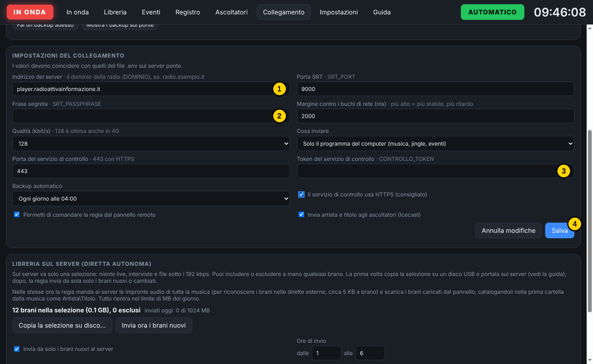

**A mano (solo se serve).** Nella scheda **Collegamento**, **Impostazioni tecniche del collegamento** contiene i singoli
valori: indirizzo del server (senza `https://`), frase segreta e token stampati dall'installazione, **Porta SRT**
9000, **Porta del servizio di controllo** 443 (9443 durante le prove) con HTTPS, **Margine contro i buchi di rete**
2000 ms (se l'audio salta, alzalo), **Qualità** 128 kbit/s.

**Cosa inviare:** *Solo il programma del computer* (musica, jingle ed eventi) oppure *Un ingresso della scheda
audio* (per esempio il mix del RodeCaster, così va in onda anche il microfono dello studio).

In alto, accanto ad AUTOMATICO/MANUALE, una scritta dice com'è il collegamento:

| Scritta | Significato |
|---|---|
| verde "✓ Gli ascoltatori ti sentono" | la regia è in onda attraverso il server |
| gialla "… Mi collego al server" | collegamento in corso: la regia riprova da sola (intanto va la musica di riserva) |
| rossa "✗ Non arrivi agli ascoltatori" | collegamento caduto: la regia riprova da sola, intanto va la musica di riserva |
| grigia "Non collegata al server" | manca il codice di collegamento: la musica si sente solo in studio |
| rossa "⚠ 2 avvisi" | il server segnala un problema: premila per leggere cosa succede |

## 22. La musica sul server

Il server ha una sua copia della musica, per la [diretta autonoma](#7-diretta-autonoma-senza-la-regia) e la musica
di riserva. Nella regia: scheda **Collegamento** → **Libreria sul server**.

**Cosa va sul server:** solo una selezione. Restano fuori:

- i **live** ("live" o "dal vivo" nel genere, nella cartella o nel titolo come "(Live)", "- Live at…"; titoli come
  "Live Forever" restano dentro);
- le **interviste** ("intervista" nel titolo, nel genere o nella cartella);
- i file sotto i **192 kbps** (modificabile);
- i brani più lunghi della [durata massima](#brani-troppo-lunghi-premixati) (premixati): questi non vanno sul
  server neanche scelti a mano.

Con **Scegli a mano** vedi gli esclusi con il motivo e puoi premere **Includi comunque**; con "Tutta la musica"
cerchi un brano e lo puoi **Escludere**. **Lascia decidere alla regola** annulla la scelta a mano. I brani sotto i
60 secondi (jingle, spot) non vengono mai scelti dalla musica di riserva.

**Prima copia (a mano, circa 100 GB):**

1. Collega un disco USB alla regia e premi **Copia la selezione su disco…**. Copia solo la selezione, già nelle
   cartelle giuste; se la interrompi, alla ripartenza salta quelli già copiati.
2. Porta il disco a casa, collegalo al server (in Proxmox: passa il disco USB alla VM) ed esegui nella VM:
   `sudo rsync -a --info=progress2 /media/<disco>/regia/ /opt/radio-ponte/musica/regia/` e poi
   `sudo chown -R 1000:1000 /opt/radio-ponte/musica`.

**Dopo, da sola:** con **Invia da solo** acceso, la regia manda via internet solo i brani **nuovi o cambiati** e
toglie dal server quelli usciti dalla selezione. Lo fa **di notte** (di base dalle 1 alle 6) e al massimo **1 GB al
giorno**, perché il 4G non è illimitato: ore e limite si cambiano nella stessa sezione (poi **Salva**). **Invia ora
i brani nuovi** parte subito, rispettando il limite. Nelle stesse ore la regia:

- manda i titoli corretti, il volume misurato e le **impronte audio** di tutta la musica (per il riconoscimento
  nelle esterne);
- **scarica i brani caricati dal pannello** e li mette nella prima cartella della musica come
  `Artista\Titolo.mp3` (se il nome è già usato: `Titolo (2).mp3`), poi li legge, li analizza, calcola l'impronta e
  cerca autori e codici su MusicBrainz.

Se un giorno la regia vedesse sparire troppi brani (per esempio il disco della musica scollegato), si ferma e non
toglie nulla dal server.

## 23. Utenti del pannello

### Invitare un utente con un link (consigliato)

Così non devi inventare tu la password e mandarla.

1. Menu **☰ → Utenti** (solo amministratori).
2. In **Invita un nuovo utente** scrivi il **nome** con cui entrerà e scegli il **ruolo**.
3. Premi **Crea link di invito**, poi **Copia** (o **Invia…** dal telefono) e mandalo, per esempio su WhatsApp.
4. Chi riceve il link lo apre, sceglie la sua password (due volte) e preme **Salva la password ed entra**: è già
   dentro il pannello. Le volte dopo entra con nome e password.

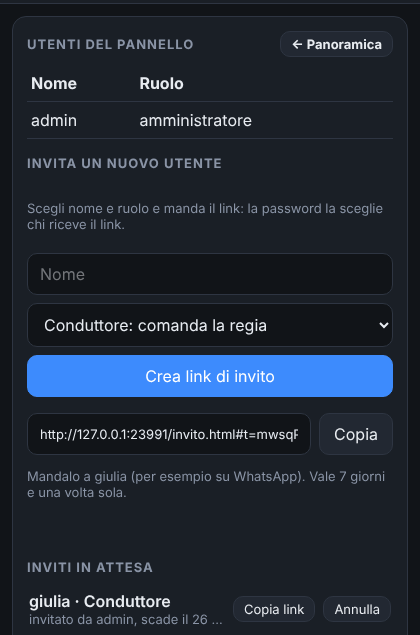

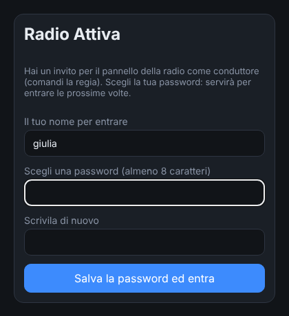

Il link vale **7 giorni** e **una volta sola**. Finché non è usato lo trovi in **Inviti in attesa**: **Copia link**
per rimandarlo, **Annulla** per farlo smettere di funzionare. Se è scaduto, creane uno nuovo.

### Creare un utente con la password

Menu **☰ → Utenti** (solo amministratori): scrivi nome, ruolo e password e premi **Salva**. Per cambiare il ruolo
di un utente scrivi il suo nome, scegli il ruolo e lascia vuota la password. Cambiando la password, l'utente viene
scollegato da tutti i dispositivi.

| Ruolo | Cosa può fare |
|---|---|
| Amministratore | tutto, compresi utenti, programmi, annunci e impostazioni del server, chiavi di YouTube e Facebook |
| Conduttore | comandare la regia, microfono, ospiti, diretta autonoma, dirette video, puntate, etichette |
| Ospite | vedere cosa va in onda e cercare nella libreria, senza comandare |

Nella regia (scheda **Collegamento**) l'opzione "Permetti di comandare la regia dal pannello remoto" è attiva di
base; la riga "Pannello remoto" dice se il collegamento è attivo. Dopo 5 password sbagliate di fila dallo stesso
indirizzo, il pannello blocca i tentativi per un minuto.

## 24. Problemi comuni

### Dirette esterne

| Problema | Cosa fare |
|---|---|
| Radio Esterna: "Nome o password sbagliati" | sono gli stessi del pannello; per andare in onda serve il ruolo conduttore o amministratore |
| Radio Esterna: "Radio Esterna è già collegata da …" | se ne può collegare una sola alla volta: chiudi l'altra (o premi **Esci**) |
| Radio Esterna: "La radio non è ancora pronta per Radio Esterna" | il server va aggiornato dal pannello (o riavviato con `riavvia.sh`, che prepara l'ingresso da solo) |
| Radio Esterna: "La radio non riceve ancora la tua voce" | aspetta qualche secondo; se resta, il server va aggiornato o riavviato con `riavvia.sh` |
| Radio Esterna: la barra del microfono non si muove | scegli un altro microfono nell'elenco; controlla che il microfono sia **🎙 Acceso** e non **🔇 Spento** |
| Radio Esterna sul Mac: nessun suono dal microfono o dal computer | Impostazioni di Sistema → Privacy e sicurezza → **Microfono** (e **Registrazione schermo e audio**): attiva Radio Esterna, poi riaprila |
| In onda si sente lo studio o un'eco | la cuffia è l'uscita principale del computer e l'audio del computer è acceso: scegli un'altra uscita per la cuffia o spegni l'audio del computer |
| L'app Icecast non si collega | controlla che sul router sia inoltrata la porta **TCP 9010** verso il server; ricontrolla indirizzo, porta, utente e password |
| L'app dice "mount" o "mountpoint" sbagliato | alcune app vogliono il mount con la barra (`/`), altre senza: prova tutti e due |
| Si collega ma non si sente nulla | nell'app controlla che sia scelto il microfono o il mixer giusto e che la barra del volume si muova |
| Mi sento con l'eco o in ritardo | in cuffia ascolta l'app o il mixer, non la radio |
| Nelle esterne non riconosce nessun brano | la regia non ha ancora mandato le impronte: guarda "Impronte audio" in Libreria e "impronte sul server" in Libreria sul server |
| Troppi brani sconosciuti che erano parlato | premi **Non è musica**: vengono tolti |
| Il bot Telegram non prende le etichette | bisogna **rispondere** al messaggio con l'audio (non scrivere un messaggio nuovo); controlla l'id della chat; con due bot nel gruppo usa `/menu@nomedelbot` |
| Nel log del server "lettura messaggi: Conflict" | lo stesso token è usato da un altro programma o è quello degli allarmi: usa un bot diverso |

### Regia

| Problema | Cosa fare |
|---|---|
| La scheda audio scelta non è disponibile | il RodeCaster è scollegato o spento |
| In manuale la regia si ferma dopo ogni brano | è normale: premi **▶ PLAY**, oppure passa in AUTOMATICO |
| "Ricerca fermata: MusicBrainz non raggiungibile" | niente internet o MusicBrainz in manutenzione da più di mezz'ora: riprova più tardi, riparte da dove era |
| "… in pausa, riprovo da solo alle …" | il servizio è occupato (errore 503): non serve fare niente, riparte da solo |
| "chiave non valida" (Discogs, Last.fm o AcoustID) | ricopia la chiave in **Impostazioni** → **Servizi per i dati dei brani** e **Salva** |
| "Ricerca fermata: fpcalc non si avvia" | il programma per l'impronta audio è bloccato (spesso dall'antivirus): sbloccalo o reinstalla la regia; i brani restano da provare |
| Il riquadro non dice "AcoustID attivo" | manca la chiave di AcoustID, oppure la regia è vecchia: aggiornala |
| "modello non scaricato" (AI) | serve internet la prima volta: premi **Riprendi lo scaricamento** |
| L'AI sbaglia giorni od orari | scrivili in modo esplicito ("dal lunedì al venerdì dalle 7 alle 10") e correggi nell'anteprima |
| Una fascia ha pochi brani (⚠) | aggiungi generi alla fascia, oppure fai la ricerca su MusicBrainz |
| Il notiziario viene sempre saltato "perché vecchio" | aumenta l'**Età massima** o scegli **Manda l'ultimo scaricato** |
| "nel feed non c'è nessun file audio" | il link è la pagina web, non il feed: cerca il link RSS del podcast |
| "voce non scaricata" o la prova resta su "Preparo la voce…" | serve internet la prima volta: premi **Scarica … adesso** e aspetta qualche minuto |
| La voce dice male un nome | scrivilo come si pronuncia (es. "Elvis Prèsli"); per le sigle usa punti o spazi |
| "replica … non disponibile" | il programma non ha puntate pubblicate, è nascosto, oppure la regia non raggiunge il server |
| Nel report mancano i brani della notte | il server non era raggiungibile: premi **Aggiorna** con il server collegato |

### Server e collegamento

| Problema | Cosa fare |
|---|---|
| "Il ponte non risponde" | porta UDP 9000 non inoltrata sul router, indirizzo sbagliato o VM spenta |
| "Frase segreta errata" | la frase segreta della regia è diversa da quella del server (pannello: **Impostazioni server** → **Avanzate**) |
| "token del ponte errato" | il token della regia è diverso da quello del server (pannello: **Impostazioni server** → **Avanzate**) |
| Il pannello non si apre, o non in https | il dominio non punta all'IP di casa, o le porte 80/443 non arrivano alla VM (`docker compose logs caddy`) |
| Il pannello dice REGIA SCOLLEGATA | regia spenta o senza internet, oppure "Permetti di comandare la regia dal pannello remoto" spento |
| Allarme Icecast secondario | dati sbagliati in **Impostazioni server** → **Icecast secondario**, oppure server esterno spento |
| Le statistiche non contano il secondario | la pagina `status-json.xsl` del secondario è chiusa: metti utente e password di amministrazione in **Icecast secondario** |
| Striscia rossa nelle Impostazioni server | "il servizio di riavvio non risponde": manca il servizio che applica le impostazioni, rilancia `sudo bash installa-server.sh`; "il server non ha detto se le ha applicate": il riavvio si è bloccato, guarda `journalctl -u radio-ponte-impostazioni` sul server |
| "la libreria del server è vuota" | fai la prima copia ([sezione 22](#22-la-musica-sul-server)) o carica brani dal pannello |
| "la selezione toglierebbe … brani dal server" | il disco della musica della regia non è collegato: ricollegalo e riprova |
| La regia non invia brani al server | fuori dalle ore di invio, limite del giorno raggiunto, oppure "Invia da solo" spento |
| La guida nel pannello dice "non è installata" | rilancia `sudo bash installa-server.sh` dalla cartella `ponte` dello ZIP |
| "No supported authentication methods" o password rifiutata via SSH | la VM accetta solo la chiave: ricreala con `CHIAVE_SSH=`, oppure dalla console `sudo sed -i 's/no/yes/' /etc/ssh/sshd_config.d/60-cloudimg-settings.conf` e `sudo systemctl restart ssh` |
| `installa-server.sh` si ferma subito con errori strani (`$'\r'`) | i file sono passati da Windows: riscarica lo ZIP, oppure nella cartella `ponte` esegui `find . -type f -exec sed -i 's/\r$//' {} +` |

### Pannello, microfono e ospiti

| Problema | Cosa fare |
|---|---|
| "Il microfono funziona solo con il pannello aperto in HTTPS" | apri il pannello con `https://` e l'indirizzo della radio |
| Il microfono si apre ma non si sente, o si chiude dopo 20 secondi | porte UDP 40000-40049 non inoltrate sul router verso la VM |
| "Permesso del microfono negato dal browser" | nelle impostazioni del sito nel browser consenti il microfono, poi ricarica la pagina |
| L'ospite dice "Link non valido o scaduto" | il link ha più di 24 ore o è stato revocato: creane uno nuovo |
| L'ospite entra ma non si sente | porte UDP 40000-40049 non inoltrate, oppure la rete dell'ospite blocca l'audio: prova con i dati del telefono |
| Pallino giallo o rosso accanto al microfono, a un ospite o all'esterna | la linea di chi parla è debole: il server si adatta da solo; se resta rosso, chi parla si sposta dove la rete prende meglio |
| Diretta video "in attesa del video da OBS" | OBS non trasmette, oppure non raggiunge la porta UDP 9020 |
| "OBS manda 1920x1080" | in OBS, Impostazioni → Video: risoluzione di uscita 1280×720 |
| "manca la chiave di YouTube/Facebook" | un amministratore deve inserirla nelle impostazioni delle dirette video |
| Un programma non si registra | controlla "Registra da solo" e le fasce; l'ora è quella italiana del server |
| L'app non trova le puntate | il nome breve della stazione è diverso da quello dell'app, oppure il programma è nascosto |
| L'annuncio del server va in onda un brano dopo | normale con la musica di riserva: il server prepara il brano successivo in anticipo |
| Gli annunci del server non partono mai | partono solo quando trasmette il server (senza regia ed esterne); controlla giorni, orario e **attivo** |

## 25. In arrivo

- Radio Esterna: registrazione della puntata che parte da sola all'orario del programma.
- Mix DJ anche sul server (diretta autonoma e musica di emergenza) e dal pannello.
- FluidStream, se un giorno servirà.

## 26. Modifiche alla guida

| Data | Novità |
|---|---|
| 14/11/2026 | Prima versione: regia (fase 1), eventi avanzati, ponte, collegamento, backup, dirette esterne, VM Proxmox |
| 15/11/2026 | Pannello remoto dal browser, utenti con ruoli, HTTPS con il certificato di AzuraCast, `riavvia.sh` |
| 15/11/2026 | Microfono dal pannello remoto: voce in onda con la musica che si abbassa, ritorno in cuffia; nuova porta UDP 40000-40049 |
| 15/11/2026 | Diretta autonoma dal server (dal pannello), libreria sul server con selezione automatica, copia su disco USB e invio notturno; disco della VM a 300 GB |
| 15/11/2026 | Ospiti in diretta con un link: sala d'attesa, fai entrare, in onda, fino a 3 insieme, ritorno in cuffia per tutti |
| 15/11/2026 | Server senza AzuraCast: Icecast principale e HTTPS automatico (Caddy) nella stessa VM; regia sulla porta 443; Icecast secondario con lo stesso segnale; musica di riserva quando nessuno è in diretta; dirette video su YouTube e Facebook (logo o OBS, massimo 720p) |
| 15/11/2026 | Report SIAE trimestrale in CSV per il portale; brani della diretta autonoma e della riserva nel registro; autori, editore, ISWC e ISRC da MusicBrainz; elenco della musica con dati mancanti |
| 15/11/2026 | Riconoscimento dei brani nelle dirette esterne con le impronte della libreria; brani sconosciuti da ascoltare ed etichettare nel pannello; i brani caricati dal pannello scendono in regia e vengono catalogati come Artista\Titolo |
| 15/11/2026 | Programmi dal pannello con fasce e copertina; registrazione automatica delle puntate, revisione e pubblicazione; pagine `podcast.html` e `ascolta.html`; API dei podcast come AzuraCast per l'app; repliche dal pannello e con gli eventi |
| 15/11/2026 | Titolo in onda, ultimi brani e ascoltatori agli indirizzi `/api/nowplaying` di AzuraCast, per l'app |
| 15/11/2026 | Statistiche degli ascoltatori nel pannello e nella regia (scheda Ascoltatori): adesso, picco, media, ore di ascolto, grafici del giorno e della settimana, per ora e per programma; storico di un anno |
| 15/11/2026 | Installazione su Proxmox passo passo: chiave SSH dal PC, copia del programma con lo ZIP, VM in DHCP; prove del server nuovo con AzuraCast ancora acceso (altro nome e porta 9443) |
| 15/11/2026 | Bot Telegram della radio: audio dei brani sconosciuti da etichettare rispondendo nella chat, "Non è musica", menu in sola lettura con stato, ascoltatori, puntate e brani etichettati |
| 15/11/2026 | Notiziari scaricati in automatico: fonti in Impostazioni (feed di un podcast o link diretto), età massima, cosa fare se manca; azione **Notiziario** negli eventi |
| 15/11/2026 | Voce sintetica gratuita (Paola o Riccardo) con regolazioni: azione **Annuncio vocale** negli eventi, notiziario mancante letto dalla voce, annunci a orario del server dal pannello |
| 16/11/2026 | Rotazioni con l'AI: palinsesto scritto a parole, fasce in anteprima da correggere, eventi **AI · …** creati da soli; modello locale scaricato una volta; generi e anno da MusicBrainz |
| 16/11/2026 | Discogs (generi e stili), Last.fm (etichette) e AcoustID (brani riconosciuti dall'audio): chiavi in Impostazioni, ricerca dalla Libreria |
| 16/11/2026 | Impostazioni del server dal pannello (menu ☰ → Impostazioni server): tutti i valori del `.env`, riavvio automatico solo delle parti cambiate, valori avanzati protetti |
| 16/11/2026 | Guida riscritta più semplice: prima le cose di tutti i giorni, poi l'installazione; screenshot con i numeri; dirette esterne passo passo (anche con BUTT); scheda **Guida** nella regia e **📖 Guida** nel menu del pannello |
| 16/11/2026 | Controllo di sicurezza: ricerche lunghissime limitate, regia che non apre pagine esterne, eventi con comando esterno spenti dopo un ripristino, frase segreta per il video da OBS, etichette e registro protetti dalle formule di Excel |
| 16/11/2026 | Secondo controllo di sicurezza: video da OBS solo con frase segreta, backup ripuliti prima del ripristino, notiziari con feed costruiti apposta, al massimo 20 accessi aperti per utente, una ricerca alla volta per pannello, microfono remoto tolto di sicuro dall'onda |
| 16/11/2026 | Indirizzi del server: `/` è il player pubblico per gli ascoltatori, il pannello si apre da `/dashboard`; pulsante **← Panoramica** in ogni sezione del pannello |
| 16/11/2026 | Categorie della musica nella Libreria e etichette tue sui brani (anche su molti insieme); ricerche su MusicBrainz e servizi che dopo un 503 riprovano e vanno in pausa invece di fermarsi |
| 16/11/2026 | Prima release (0.1.0, anteprima): installer della regia e ZIP del server si scaricano dalla pagina delle release |
| 17/11/2026 | Ricerca dei brani della regia (In onda, jingle, eventi) con il filtro per categoria o etichetta tua |
| 17/11/2026 | Player pubblico più semplice con le copertine dei brani (iTunes, Deezer); musica di riserva con titolo e artista, sempre da un brano nuovo e solo dopo 8 secondi senza programma |
| 17/11/2026 | Durata massima dei brani (10 minuti, dal pannello): i premixati spariscono da libreria, rotazioni, eventi, server, diretta autonoma e musica di emergenza |
| 19/11/2026 | Utenti del pannello invitati con un link (7 giorni, una volta sola): la password la sceglie chi lo riceve |
| 19/11/2026 | Schede di benvenuto al primo accesso nel pannello, adatte al ruolo; si rivedono dal menu ☰ → 👋 Benvenuto |
| 20/11/2026 | Analisi per il Mix DJ in Libreria: BPM, battiti, tonalità, energia, intro e outro di ogni brano |
| 20/11/2026 | Mix DJ in regia: pulsante "Mixa il prossimo", azione "Mix DJ" negli eventi e impostazione per i cambi automatici |
| 23/11/2026 | Energia dei brani nella rotazione (salti massimi di 2 punti, fascia di energia nei profili e nelle rotazioni con l'AI); con il Mix DJ acceso precedenza ai brani mixabili |
| 23/11/2026 | Conto alla rovescia dell'intro del brano in onda ed etichetta "intro N s" in coda, in regia e nel pannello |
| 23/11/2026 | Passaggi del Mix DJ: filtro, eco, riverbero, stacco, rullo, frenata e riavvolto, scelti dalla regia o a mano; passaggi permessi nelle Impostazioni |
| 23/11/2026 | Con il Mix DJ acceso la rotazione cambia tempo ogni 4-6 brani, dentro la fascia di energia |
| 23/11/2026 | Eventi e rotazioni della regia da remoto: dal pannello (anche rotazioni con l'AI) e dal bot Telegram |
| 23/11/2026 | Pannello impaginato per telefono e PC (tre colonne sugli schermi larghi); libreria della diretta autonoma solo quando la avvii |
| 23/11/2026 | Due microfoni insieme dal pannello (due microfoni USB o i 2 ingressi di una scheda audio), ognuno con volume e muto |
| 23/11/2026 | Programmi fatti dallo studio: registrazione in regia da palinsesto o a mano, segni di inizio e fine, interruzioni del collegamento; Stereo Tool sulle registrazioni della regia; revisione delle puntate anche da Telegram |
| 24/11/2026 | Titolo quando si parla: senza brani in onda va il nome del programma con il conduttore (o il nome della radio) invece dell'ultimo brano; testo in più dalla regia o dal pannello; nelle esterne vale il titolo dell'app se lo manda |
| 24/11/2026 | App **Radio Esterna** per Windows e Mac: installazione, accesso con l'utente del pannello, fuori onda e IN ONDA, titolo del programma, mixer con microfoni e audio del computer, cuffia e ritorno, registrazione della puntata, scheda Regia; riquadro dell'esterna in regia e nel pannello |
| 24/11/2026 | Scheda Programmi in regia: crea, modifica ed elimina i programmi del server e la loro copertina |
| 25/11/2026 | Mix DJ più preciso: brani agganciati battuta per battuta e posizione vera del brano in onda; nuova analisi per il Mix DJ in sottofondo |
| 26/11/2026 | Dirette esterne più stabili: Radio Esterna con collegamento veloce (WebRTC) e riserva HTTPS automatica, ritorno in cuffia quasi senza ritardo, pallino della qualità della linea in app, regia e pannello (anche microfono e ospiti) |
| 26/11/2026 | Regia più semplice: Benvenuto alla prima accensione, codice di collegamento dal pannello, conferme su STOP / Svuota / MANUALE / Rimuovi cartella, avviso quando la musica sta per finire, scritte chiare sul collegamento, Testo grande, cose avanzate nascoste; impostazioni della musica a scelte, una sola barra di preparazione in Libreria, eventi già pronti, messaggi di errore con cosa fare |
| 26/11/2026 | Rotazioni con l'AI: **Esporta per Claude** e **Importa piano** (file .md) spiegati, ora anche nel pannello del server |
| 27/11/2026 | Radio Esterna a prova di anziano: frasi in alto, pulsanti e messaggi senza parole tecniche, conferme (FUORI ONDA, Programma finito, Togli microfono, Esci), **Testo grande**, regolazioni tecniche dietro **Avanzate**; riquadro di chi è fuori in regia e nel pannello con frasi semplici |
| 27/11/2026 | Player della radio installabile come app (telefono e computer), icona dal logo |
| 27/11/2026 | Parti che non sono musica (silenzio, parlato, applausi, rumore, tracce fantasma) tagliate da sole all'inizio e alla fine dei brani, in regia e sul server; durata minima di 2 minuti di musica per le scelte automatiche |
